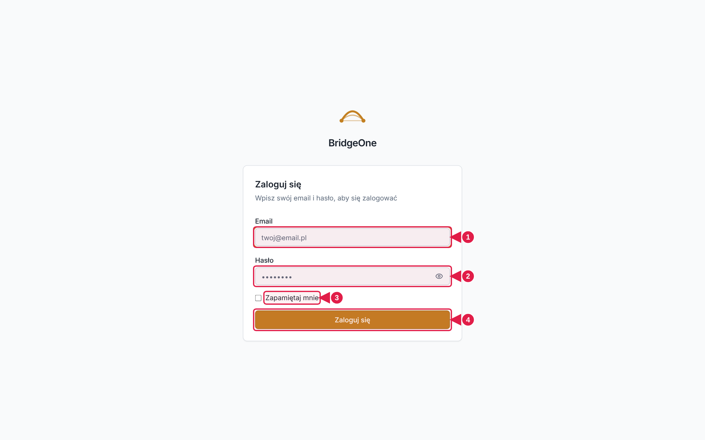
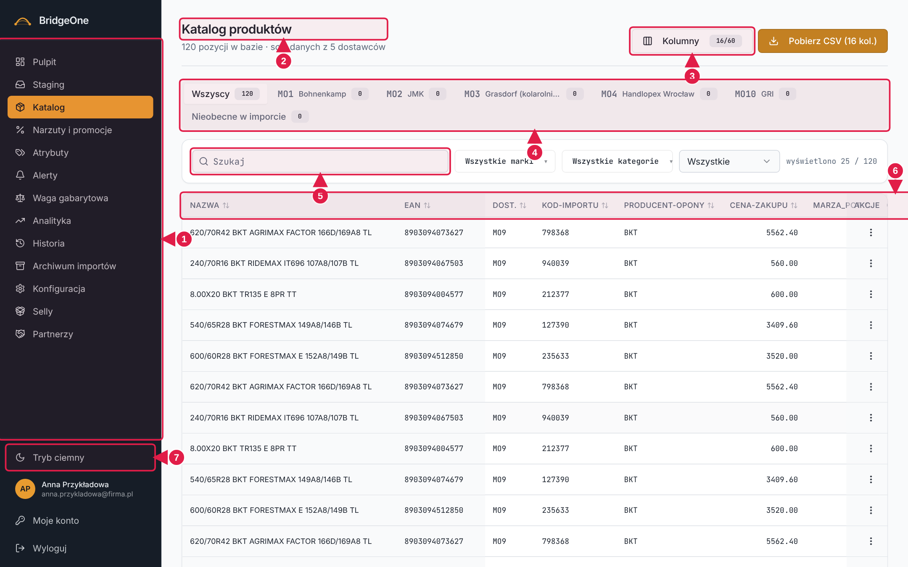
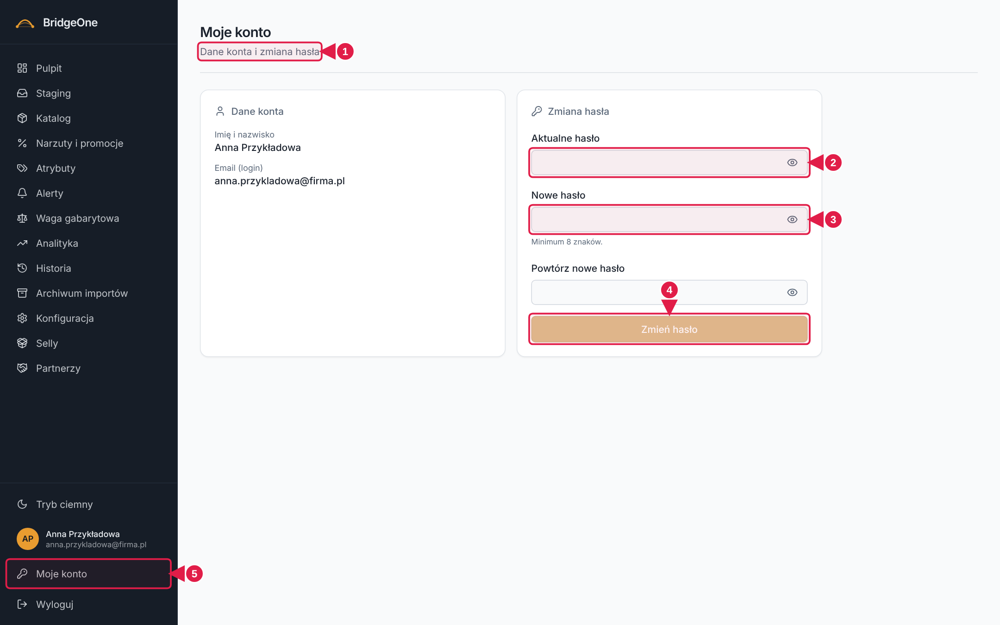

# Podręcznik Bridge — rozdział 0: Start i nawigacja po panelu

> Spis wszystkich rozdziałów: [README.md](README.md).
>
> **Gdzie ćwiczyć:** ćwiczenia z oznaczeniem ⚠ **zmieniają dane**. Wykonuj je na **środowisku testowym:
> https://training.agroopony.eu**, nie na produkcji (`bridgeone.agroopony.eu`). Ćwiczenia bez ⚠ tylko oglądają
> dane i są bezpieczne wszędzie.

---

## 1. Jak czytać ten podręcznik

Każdy rozdział ma tę samą budowę:

1. **📍 Jak tu wejść** — gdzie kliknąć, żeby trafić na ekran.
2. **Do czego służy** — jedno krótkie wyjaśnienie.
3. **Opis ekranu** — co jest gdzie (góra, lewa strona, dół tabeli…).
4. **Sekcje z funkcjami**, a w każdej blok **✍️ Ćwiczenia** — numerowane kroki „kliknij tu, wpisz to, sprawdź tamto".
   Ćwiczenia wykonuj po kolei: późniejsze korzystają z umiejętności z wcześniejszych.
5. **✅ Umiesz, gdy…** — krótki sprawdzian, że sekcja jest opanowana.

**Słownik kierunków używany w całym podręczniku:**

| Zwrot | Znaczy |
|---|---|
| **menu po lewej** | ciemny pasek z nazwami ekranów, widoczny na każdym ekranie |
| **na samym dole menu po lewej** | blok pod listą ekranów: tryb ciemny, Twoje dane, „Moje konto", „Wyloguj" |
| **nagłówek strony** | duży tytuł ekranu na samej górze, np. „Katalog produktów", z podtytułem pod spodem |
| **prawy górny róg** | przyciski po prawej stronie nagłówka strony (np. „Kolumny", „Pobierz CSV"). Na wąskim ekranie przesuwają się pod tytuł |
| **zakładki** | rząd przycisków pod nagłówkiem, między którymi się przełączasz (np. „Narzuty" / „Promocje") |
| **pasek filtrów** | białe pole pod zakładkami z szukajką i listami wyboru |
| **menu ⋮ (Akcje)** | trzy pionowe kropki na końcu (po prawej) wiersza tabeli |
| **okno** | okienko, które wyskakuje na środku ekranu; przyciski na jego dole po prawej (np. „Anuluj" i „Zapisz") |
| **komunikat** | krótka plakietka (toast) pojawiająca się w rogu ekranu po akcji, np. „Zapisano zmiany" |

---

## 2. Logowanie

📍 Wejdź na adres panelu (produkcja `bridgeone.agroopony.eu`, ćwiczenia: `training.agroopony.eu`).

**Ekran logowania**

1. Pole **Email** (Twój login)
2. Pole **Hasło** z ikonką oka (pokazuje/ukrywa hasło)
3. Haczyk **Zapamiętaj mnie**
4. Przycisk **Zaloguj się**

Ekran logowania ma tylko wycentrowaną kartę „Zaloguj się" — **menu po lewej tu nie ma** (tak ma być).

- **Email** (twój login) i **Hasło**. Ikonka oka w polu hasła pokazuje/ukrywa wpisane znaki.
- **Zapamiętaj mnie** — zaznacz, jeśli nie chcesz logować się za każdym razem na swoim komputerze.
- Przycisk **Zaloguj się**. Przy złym haśle pojawia się czerwony komunikat o błędzie logowania.

### ✍️ Ćwiczenia 2 — logowanie
1. Wpisz swój email i **błędne** hasło, kliknij **Zaloguj się**. Przeczytaj komunikat.
2. Kliknij ikonkę oka w polu hasła — hasło staje się widoczne. Kliknij ponownie, aby je ukryć.
3. Wpisz poprawne hasło i zaloguj się. Powinieneś/powinnaś trafić na **Pulpit**.

✅ *Umiesz, gdy:* logujesz się bez zastanawiania się i wiesz, że zły komunikat nie oznacza awarii.

---

## 3. Układ ekranu po zalogowaniu

Panel ma stały układ:

**Rzeczywisty wygląd panelu (przykład: ekran Katalog)**

1. **Menu po lewej** — lista wszystkich ekranów (aktywny podświetlony)
2. **Nagłówek strony** — tytuł i podtytuł
3. **Prawy górny róg** — przyciski akcji ekranu
4. **Zakładki** (tu: dostawcy)
5. **Pasek filtrów** — szukajka i listy wyboru
6. **Tabela** z danymi (nagłówki kolumn sortują)
7. **Dół menu** — Tryb ciemny, Twoje konto, Moje konto, Wyloguj

### Menu po lewej — wszystkie ekrany (od góry do dołu)

| # | Pozycja menu | Do czego | Rozdział |
|---|---|---|---|
| 1 | **Pulpit** | codzienny przegląd: liczby, alerty, dostawcy | 01 |
| 2 | **Staging** | poczekalnia nowych/zmienionych pozycji do akceptacji | 02 |
| 3 | **Katalog** | wszystkie produkty: szukanie, edycja, eksport | 03 |
| 4 | **Narzuty i promocje** | reguły cen i rabaty | 04 |
| 5 | **Atrybuty** | słowniki: marki, kategorie, sezony… | 05 |
| 6 | **Alerty** | ostrzeżenia o imporcie i o katalogu | 06 |
| 7 | **Waga gabarytowa** | kalkulatory wagi do wyceny przesyłki | 07 |
| 8 | **Analityka** | wykresy i raporty | 08 |
| 9 | **Historia** | dziennik zmian w katalogu | 09 |
| 10 | **Archiwum importów** | surowe pliki od dostawców | 09 |
| 11 | **Konfiguracja** | dostawcy, wgrywanie plików, ustawienia | 10 |
| 12 | **Selly** | integracja ze sklepem Selly | 11 |
| 13 | **Partnerzy** | cenniki B2B dla partnerów | 12 |

Aktualnie otwarty ekran jest **podświetlony** w menu.

### Na samym dole menu po lewej
Zjedź wzrokiem pod listę ekranów — oddzielona linią jest druga część menu:

1. **Tryb ciemny / Tryb jasny** — przełącza wygląd całego panelu; wybór zostaje zapamiętany w przeglądarce.
2. **Kółko z inicjałami, imię i nazwisko oraz email** — informacja, na jakie konto jesteś zalogowana/y.
3. **Moje konto** (ikona klucza) — zmiana hasła (sekcja 5 poniżej).
4. **Wyloguj** (ikona wyjścia) — kończy sesję i wraca do ekranu logowania.

### Na telefonie lub wąskim oknie
Menu po lewej chowa się. Na górze ekranu jest pasek z logo „BridgeOne" i **przyciskiem ☰ w prawym górnym rogu**.
Kliknij go, aby wysunąć menu; wybranie ekranu zamyka je samo. Kliknięcie ciemnego tła poza menu też je zamyka.

### ✍️ Ćwiczenia 3 — poruszanie się po panelu
1. Po zalogowaniu znajdź w menu po lewej pozycję **Katalog** i kliknij ją. Sprawdź, że jest podświetlona.
2. Przejdź kolejno przez **wszystkie 13 pozycji** menu. Przy każdej odnajdź nagłówek strony i zapisz sobie jego tytuł.
3. Wejdź w **Katalog** i w prawym górnym rogu znajdź dwa przyciski: **Kolumny** i **Pobierz CSV**.
4. Zjedź na sam dół menu po lewej i kliknij **Tryb ciemny**. Zobacz, jak zmienia się wygląd. Wróć do **Trybu jasnego**.
5. Odśwież stronę (F5). Sprawdź, że wybrany wygląd został zapamiętany.
6. Zmniejsz okno przeglądarki (lub otwórz panel na telefonie). Znajdź przycisk **☰** w prawym górnym rogu i otwórz menu.

✅ *Umiesz, gdy:* z zamkniętymi oczami wiesz, że lista ekranów jest po lewej od góry, a tryb ciemny, „Moje konto"
i „Wyloguj" — na dole po lewej.

---

## 4. Rzeczy wspólne dla wszystkich ekranów

- **Szukajka filtruje na bieżąco** — nie ma przycisku „Szukaj"; lista zawęża się podczas pisania.
- **Listy wyboru** (strzałka ▼) — kliknij, aby rozwinąć. Niektóre pozwalają zaznaczyć kilka pozycji (z haczykami).
- **Tabele**: kliknięcie nagłówka kolumny zwykle sortuje; na dole bywa przełącznik „Na stronie: 25/50/100" i przyciski
  „Poprzednia / Następna".
- **Okna pytające** („Usunąć…?") mają zawsze dwa przyciski na dole po prawej: bezpieczny **Anuluj/Zamknij**
  i właściwy (często czerwony, np. **Usuń**). Klawisz Esc też zamyka okno bez zapisu.
- **Komunikaty** po akcjach (zielone/czerwone plakietki) mówią, czy się udało — czytaj je.
- **Odświeżenie strony (F5)** niczego nie psuje; ustawienia widoku (np. wybrane kolumny) są zapamiętane.

---

## 5. Moje konto i wylogowanie

📍 Menu po lewej → zjedź **na sam dół** → **Moje konto** (ikona klucza), tuż nad „Wyloguj".

Ekran ma dwie karty:
- **Dane konta** — Imię i nazwisko oraz Email (login). Tylko do odczytu.
- **Zmiana hasła** — pola **Aktualne hasło**, **Nowe hasło**, **Powtórz nowe hasło** i przycisk **Zmień hasło**.
  Pod polami pojawiają się czerwone podpowiedzi: „Za krótkie", „Musi być inne niż aktualne", „Hasła nie są identyczne".

**Ekran „Moje konto"**

1. **Dane konta** (tylko do odczytu)
2. **Aktualne hasło**
3. **Nowe hasło** i **Powtórz**
4. **Zmień hasło**
5. **Moje konto** i **Wyloguj** — na dole menu po lewej

### ✍️ Ćwiczenia 5 — konto (⚠ tylko środowisko testowe)
1. Menu po lewej → na dole **Moje konto**. Sprawdź, czy imię i email się zgadzają.
2. W polu **Nowe hasło** wpisz 2 znaki. Zobacz podpowiedź „Za krótkie".
3. Wpisz dłuższe hasło, a w **Powtórz** — inne. Zobacz „Hasła nie są identyczne".
4. Wpisz w **Aktualne hasło** błędne hasło i kliknij **Zmień hasło** — dostaniesz błąd.
5. Wpisz poprawne aktualne i dwa razy nowe hasło, kliknij **Zmień hasło**. Zapamiętaj nowe hasło!
6. Na dole menu po lewej kliknij **Wyloguj**. Zaloguj się ponownie nowym hasłem.

✅ *Umiesz, gdy:* potrafisz zmienić hasło i wiesz, gdzie jest „Wyloguj".
