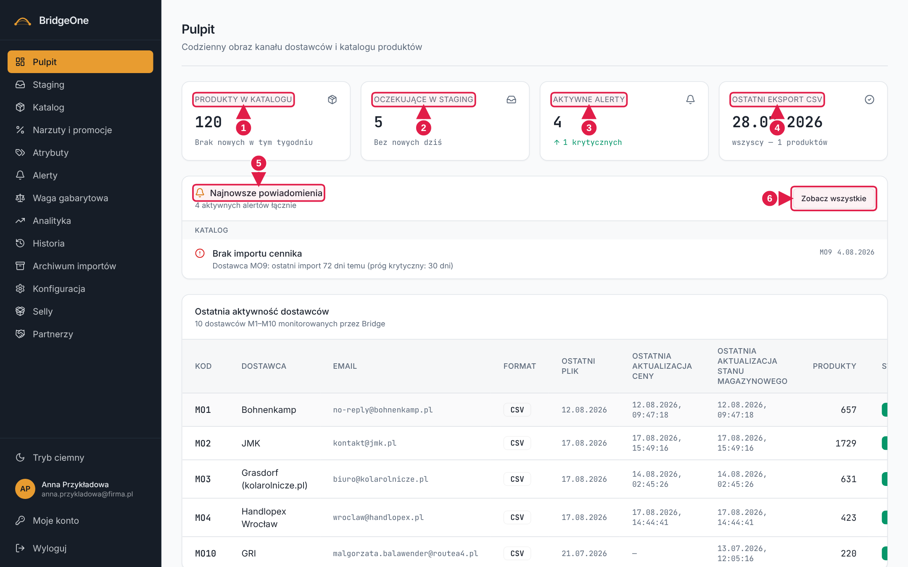
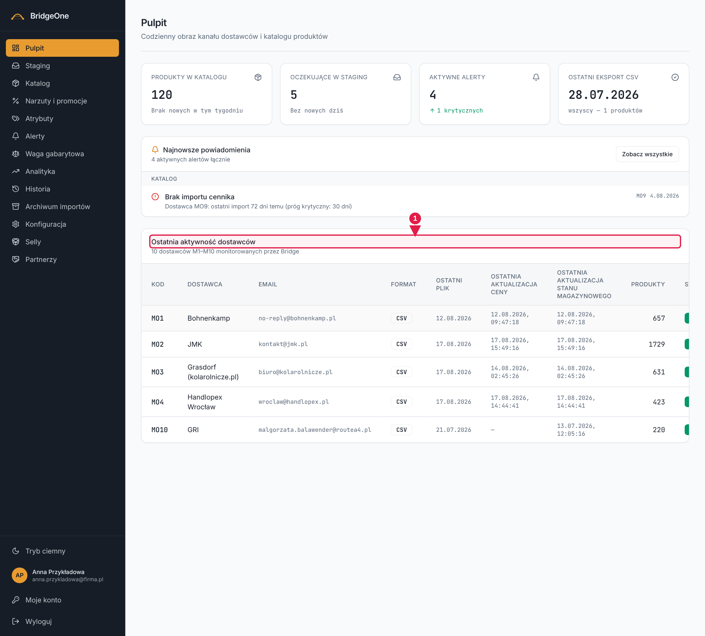

# Podręcznik Bridge — rozdział 1: Pulpit

> Wersja robocza (2026-10-16). Konwencje i słownik kierunków: [rozdział 0](00-start-i-nawigacja.md).
> Ćwiczenia na tym ekranie **tylko oglądają dane** — są bezpieczne także na produkcji.

📍 **Jak tu wejść:** menu po lewej → **Pulpit** (pierwsza pozycja od góry). Pulpit otwiera się też zaraz po zalogowaniu.

## Do czego służy

Pulpit to „rzut oka na dzień": ile jest produktów, ile czeka na akceptację, czy są alerty i co słychać u dostawców.
Niczego tu nie edytujesz — **kafelki i linki prowadzą do właściwych ekranów**.

## Jak wygląda

Od góry do dołu:
1. **Nagłówek** „Pulpit" z podtytułem „Codzienny obraz kanału dostawców i katalogu produktów".
2. **Cztery kafelki** w jednym rzędzie:
   | Kafelek | Co mówi | Dokąd prowadzi po kliknięciu |
   |---|---|---|
   | **Produkty w katalogu** | liczba pozycji; pod nią „+N w tym tygodniu" | Katalog |
   | **Oczekujące w staging** | ile pozycji czeka na akceptację; „+N nowych dziś" | Staging |
   | **Aktywne alerty** | liczba nierozwiązanych alertów; „N krytycznych" | Alerty |
   | **Ostatni eksport CSV** | kiedy był ostatni eksport i ile produktów (albo „Ostatni import: …") | Historia |
3. **Najnowsze powiadomienia** — dwie podkarty, **Import** i **Katalog**, z listą najnowszych alertów. Link
   **„Zobacz wszystkie"** (prawy górny róg tej karty) prowadzi do ekranu Alerty; nagłówek karty podaje łączną
   liczbę aktywnych alertów. Kliknięcie alertu z podkarty „Katalog" otwiera zakładkę „Katalog" w Alertach.
4. **Ostatnia aktywność dostawców** — tabela na dole: Kod, Dostawca, Email, Format, Ostatni plik, Ostatnia
   aktualizacja ceny, Ostatnia aktualizacja stanu magazynowego, Produkty, Status. Status „Błąd" (czerwony) lub
   „Wstrzymany" (szary) wymaga uwagi.

**Pulpit — kafelki i powiadomienia**

1. Kafelek **Produkty w katalogu** (klik → Katalog)
2. Kafelek **Oczekujące w staging** (klik → Staging)
3. Kafelek **Aktywne alerty** (klik → Alerty)
4. Kafelek **Ostatni eksport CSV** (klik → Historia)
5. Karta **Najnowsze powiadomienia**
6. Link **Zobacz wszystkie** (→ Alerty)

> **Uwaga:** na kafelku „Aktywne alerty" liczą się razem alerty z importu i alerty katalogowe (np. ujemna marża).

**Pulpit — tabela dostawców (po zjechaniu w dół)**

1. Tabela **Ostatnia aktywność dostawców** — sprawdź kolumnę Status

### ✍️ Ćwiczenia 1 — czytanie Pulpitu
1. Menu po lewej → **Pulpit**. Odczytaj z kafelka „Produkty w katalogu" liczbę pozycji.
2. Kliknij kafelek **Produkty w katalogu** — trafisz do Katalogu. Sprawdź, czy liczba w podtytule jest ta sama.
   Wróć do Pulpitu klikając **Pulpit** w menu po lewej.
3. Kliknij kafelek **Oczekujące w staging**. Zobacz, ile pozycji czeka. Wróć na Pulpit.
4. Kliknij kafelek **Aktywne alerty** i sprawdź, czy lista alertów zgadza się z liczbą. Wróć.
5. Kliknij kafelek **Ostatni eksport CSV**; zobacz, że otwiera się Historia. Wróć.
6. Zjedź na dół Pulpitu do tabeli „Ostatnia aktywność dostawców" i znajdź dostawcę ze statusem innym niż normalny
   (jeśli taki jest). Zapisz jego kod.
7. W karcie „Najnowsze powiadomienia" kliknij **Zobacz wszystkie** i sprawdź, że lądujesz w Alertach.

✅ *Umiesz, gdy:* po wejściu na Pulpit w 30 sekund wiesz, czy coś wymaga Twojej uwagi (staging, alerty, dostawca w błędzie).
