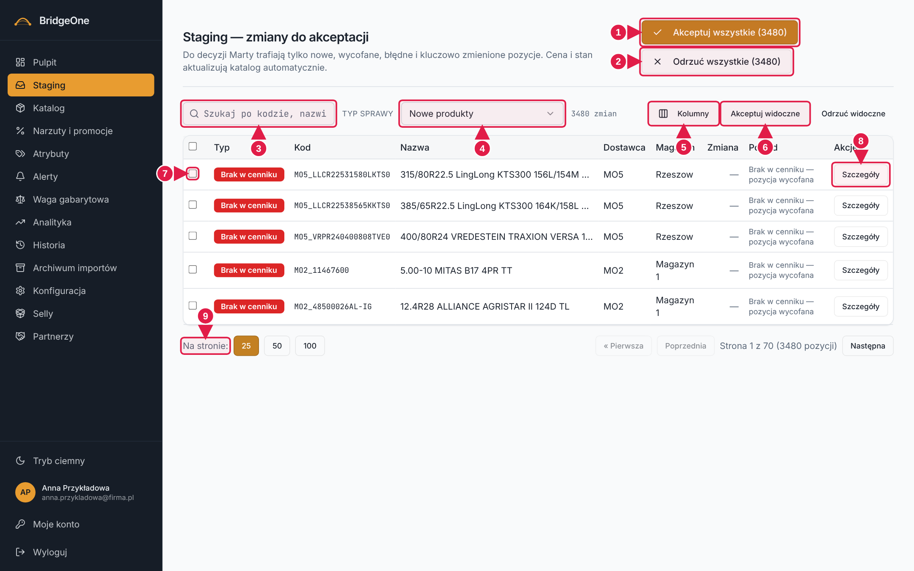
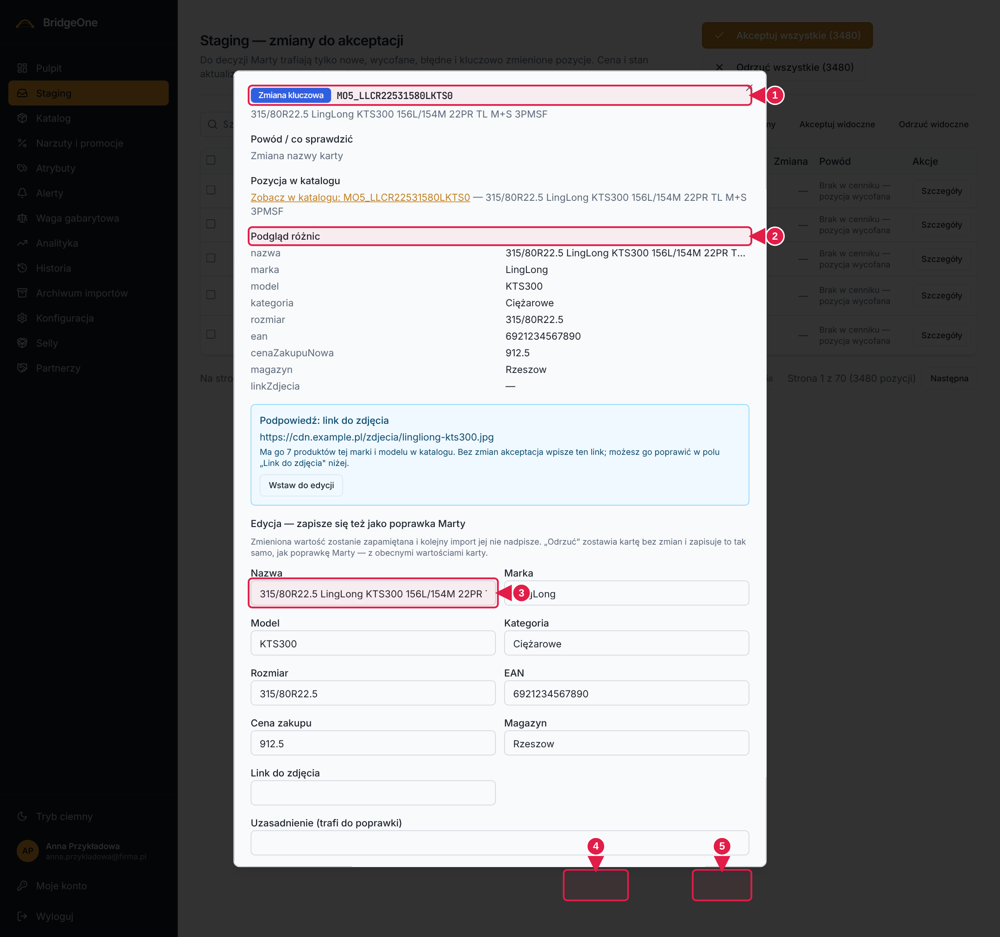

# Podręcznik Bridge — rozdział 2: Staging (poczekalnia)

> Wersja robocza (2026-10-16). Konwencje: [rozdział 0](00-start-i-nawigacja.md).
> ⚠ Ćwiczenia z akceptacją/odrzuceniem **zmieniają katalog** — wykonuj je tylko na środowisku testowym
> (**https://training.agroopony.eu**).

📍 **Jak tu wejść:** menu po lewej → **Staging** (druga pozycja od góry, ikona skrzynki). Szybka droga: kafelek
„Oczekujące w staging" na Pulpicie.

## Do czego służy

Staging to **kolejka do akceptowania pozycji produktów**. Gdy dostawca przyśle cennik, nowe i zmienione pozycje
nie wchodzą od razu do Katalogu — czekają tu na Twoją decyzję: **akceptuj** (wejdzie do katalogu) albo **odrzuć**.
Zwykłe zmiany ceny i stanu aktualizują katalog same i do Stagingu nie trafiają.

Do kolejki trafiają: **nowe** produkty, **braki w cenniku** (pozycje, których dostawca przestał przysyłać),
**zmiany kluczowe** (np. zmiana nazwy lub EAN istniejącej karty) i **błędy importu**.

## Jak wygląda ekran

1. **Nagłówek** „Staging — zmiany do akceptacji". W **prawym górnym rogu** dwa duże przyciski:
   **Akceptuj wszystkie (N)** i **Odrzuć wszystkie (N)** — działają na *wszystko, co pasuje do filtra* (nie tylko na widoczną stronę).
2. **Pasek filtrów** (od lewej): pole **Szukaj po kodzie, nazwie, dostawcy lub EAN…**, lista **Typ sprawy**,
   licznik „N zmian", a po prawej: przyciski akcji na zaznaczonych, **Kolumny** i **Akceptuj widoczne / Odrzuć widoczne**.
3. **Tabela**: kolumna haczyków (po lewej), a dalej Typ, Kod, Nazwa, Dostawca, Magazyn, Stan, Cena zakupu,
   Cena sprzedaży, Zmiana, Powód — oraz **Akcje** na końcu wiersza.
4. **Na dole**: „Na stronie:", przyciski stron i przechodzenie między stronami.

**Staging — ekran główny**

1. **Akceptuj wszystkie (N)** — wszystko wg filtra
2. **Odrzuć wszystkie (N)**
3. **Szukaj** po kodzie, nazwie, dostawcy, EAN
4. Lista **Typ sprawy** (Nowe, Braki w cenniku, Zmiany kluczowe, Błędy)
5. **Kolumny** — wybór widocznych kolumn
6. **Akceptuj widoczne / Odrzuć widoczne** — cała strona
7. **Haczyki** — zaznacz pozycje
8. **Szczegóły** — podgląd i edycja pozycji
9. **Na stronie** i przechodzenie między stronami

### Typ sprawy (lista rozwijana)
| Opcja | Co pokazuje |
|---|---|
| Wszystkie | wszystko |
| **Nowe produkty** *(domyślna)* | pozycje, których nie ma w katalogu |
| Nowe produkty (stare) | pozostałość po starszym zapisie — zwykle pusto |
| **Braki w cenniku** | pozycje nieobecne w cenniku (czerwona odznaka „Brak w cenniku") |
| **Zmiany kluczowe** | zmiana istniejącej karty (żółta/pomarańczowa odznaka) |
| **Błędy importu** | pozycje z błędem w pliku dostawcy |

> **Ważne:** przyciski „Akceptuj wszystkie (N)" / „Odrzuć wszystkie (N)" działają **w zakresie aktualnie wybranego
> „Typu sprawy"**. Zawsze sprawdź, co masz wybrane w filtrze, zanim klikniesz.

### ✍️ Ćwiczenia 2.1 — rozejrzenie się
1. Menu po lewej → **Staging**. Odczytaj z paska filtrów licznik „N zmian".
2. Rozwiń listę **Typ sprawy** i wybierz po kolei „Braki w cenniku", „Zmiany kluczowe", „Błędy importu", potem „Nowe produkty".
   Przy każdej zapisz, ile jest zmian.
3. W polu **Szukaj** wpisz fragment kodu lub nazwy produktu. Wyczyść pole.
4. Kliknij przycisk **Kolumny** (pasek filtrów, po prawej) i odznacz „Cena sprzedaży". Zobacz, że kolumna zniknęła.
   Zaznacz ją ponownie.
5. Na dole przełącz „Na stronie" na większą wartość, a potem przejdź przyciskami na kolejną stronę.

✅ *Umiesz, gdy:* potrafisz powiedzieć, ile jest nowych produktów, ile braków i ile błędów.

---

## Szczegóły pozycji (przycisk „Szczegóły")

📍 W wierszu, kolumna **Akcje** (po prawej) → **Szczegóły**.

Okno **„Pozycja stagingu"** pokazuje **Podgląd różnic** (co się zmienia: wartość w katalogu → wartość z cennika),
a poniżej **pola do edycji** (Nazwa, Marka, Model, Kategoria, Rozmiar, EAN, Cena zakupu, Magazyn, Link do zdjęcia).
Przyciski na dole: **Zamknij**, w razie potrzeby **Odrzuć** (dla zmian kluczowych) i **Zapisz**.

- Jeśli zmienisz pole, zostanie ono zapisane jako **poprawka ręczna** — kolejne importy jej nie nadpiszą.
  Możesz dopisać **Uzasadnienie** (trafi do poprawki).
- Dla produktu bez zdjęcia okno może pokazać niebieską **Podpowiedź: link do zdjęcia**; przycisk **Wstaw do edycji**
  wkleja ją do pola.
- Przy pozycji „Brak w cenniku" okno informuje, że po akceptacji produkt zostanie **wstrzymany**, a jego stan wyzerowany.
- **Zapisz** zapisuje Twoje poprawki w zgłoszeniu; samą pozycję akceptujesz potem z listy (haczyk + Akceptuj).

**Okno „Szczegóły" pozycji**

1. **Nagłówek okna** — typ zmiany i kod pozycji
2. **Podgląd różnic** — co się zmienia
3. **Pola do edycji** — Twoja zmiana zapisze się jako poprawka
4. **Zamknij** — wyjście bez zmian
5. **Zapisz** — zapisuje poprawki w zgłoszeniu

### ✍️ Ćwiczenia 2.2 — szczegóły ⚠ (środowisko testowe)
1. Wybierz typ **Nowe produkty**. W pierwszym wierszu kliknij **Akcje → Szczegóły**.
2. Przeczytaj **Podgląd różnic**. Co jest nowe?
3. Zmień **Nazwę** o jedno słowo, dopisz **Uzasadnienie** i kliknij **Zapisz**. Okno się zamknie.
4. Otwórz **Szczegóły** ponownie — sprawdź, że Twoja zmiana jest widoczna.
5. Zamknij okno przyciskiem **Zamknij** (bez zmian).

---

## Akceptowanie i odrzucanie

Cztery sposoby, od najbezpieczniejszego:

1. **Pojedyncze/wybrane pozycje:** zaznacz haczyki w pierwszej kolumnie (haczyk w nagłówku zaznacza całą stronę).
   Po zaznaczeniu na pasku filtrów **po prawej** pojawiają się **Akceptuj zaznaczone (N)** i **Odrzuć zaznaczone (N)**.
2. **Cała widoczna strona:** **Akceptuj widoczne** / **Odrzuć widoczne** (pasek filtrów, po prawej).
3. **Wszystko wg filtra:** **Akceptuj wszystkie (N)** / **Odrzuć wszystkie (N)** (prawy górny róg nagłówka) —
   zawsze pytają o potwierdzenie.
4. Po akcji pojawia się komunikat „Przetworzono pozycji: N".

> **Odrzucenie** zmiany kluczowej zostawia kartę w katalogu bez zmian i **zapamiętuje to jako poprawkę ręczną**,
> żeby ta sama propozycja nie wracała po każdym imporcie. Okno potwierdzenia mówi, ile takich pozycji dotyczy.
>
> **Duże operacje** (tysiące pozycji) mogą trwać kilkanaście minut — panel wygląda wtedy na „zawieszony".
> Zaczekaj albo zawęź filtr.

### ✍️ Ćwiczenia 2.3 — akceptacja ⚠ (środowisko testowe)
1. Wybierz typ **Nowe produkty** i wpisz w Szukaj kod jednej pozycji, żeby została jedna.
2. Zaznacz jej haczyk. Kliknij **Akceptuj zaznaczone (1)**. Sprawdź komunikat „Przetworzono pozycji: 1".
3. Wejdź w **Katalog**, wpisz kod w Szukaj — produkt powinien tam być.
4. Wróć do Stagingu. Zaznacz inną pozycję i kliknij **Odrzuć zaznaczone**. Przeczytaj pytanie (jeśli się pojawi) i potwierdź.
5. Kliknij **Akceptuj wszystkie (N)**, przeczytaj pytanie i **Anuluj** (nie potwierdzaj!). Sprawdź, że licznik się nie zmienił.

---

## Pozycje, których nie da się zaakceptować od razu

### Okno „Nie zapisano zmian"
Panel odmawia akceptacji, gdy zgłoszenie jest niewiarygodne, i **mówi, co zrobić**. Najczęstsze powody:
- *„To zgłoszenie pochodzi ze starego importu. Odśwież cennik przed akceptacją."* → **Konfiguracja → Dostawcy →
  Synchronizuj** (rozdział 10), wróć do Stagingu.
- *„Brak trzech wiarygodnych potwierdzeń nieobecności."* → pozycja musi zniknąć z trzech kolejnych pełnych cenników,
  zanim uznamy ją za wycofaną.
- *„Błędny EAN: popraw numer w edycji zgłoszenia."* → **Szczegóły**, popraw EAN, **Zapisz**.
- *„Najpierw rozstrzygnij dopasowanie opony przyciskiem Rozstrzygnij."*

### Przycisk „Rozstrzygnij" / „Sprawdź kartę"
📍 W wierszu → kolumna **Akcje** → pomarańczowy przycisk **obok „Szczegóły"** (pojawia się tylko tam, gdzie jest potrzebny).

Otwiera okno z jedną z trzech spraw:
| Tytuł okna | O co chodzi | Co robisz |
|---|---|---|
| **Porównaj starą kartę z obecną ofertą** | w katalogu jest stara karta, a w cenniku podobna pozycja | wybierasz „Zostaw tę kartę" i klikasz **Zapisz wybór w katalogu** |
| **Sprawdź dopasowanie opony** | panel nie jest pewien, do którego produktu pasuje pozycja | wybierasz produkt z listy albo „To osobna opona. Przygotuj ją jako nowy produkt" |
| **Błędny EAN w cenniku** | dostawca podał błędny EAN | wpisujesz „Poprawny EAN" albo wybierasz „Zostaw EAN z katalogu" |
| (dwa wiersze z jednego pliku) | dwa wiersze na jedną kartę, dane się różnią | **Połącz w jeden produkt** albo **Rozdziel na dwa osobne produkty** |

> ⚠ **DOT:** jeśli okno pisze „DOT: RÓŻNY — nie łączyć", to inna opona — **nie łącz kart**.
> Decyzja zapisuje się **od razu w katalogu** (bez osobnej akceptacji).

### ✍️ Ćwiczenia 2.4 — rozstrzyganie ⚠ (środowisko testowe)
1. Spróbuj zaakceptować pozycję z odznaką „Brak w cenniku". Przeczytaj okno „Nie zapisano zmian".
2. Znajdź w tabeli pomarańczowy przycisk **Rozstrzygnij** lub **Sprawdź kartę** i kliknij go.
3. Przeczytaj, „Dlaczego to zgłoszenie czeka na decyzję". Porównaj dwie karty obok siebie.
4. Jeśli opcja „Zobacz tę pozycję w katalogu" jest dostępna — kliknij ją, by porównać z Katalogiem, i wróć.
5. Kliknij **Zamknij** (bez zapisu). Pozycja ma pozostać w kolejce.

✅ *Umiesz, gdy:* przy odmowie akceptacji wiesz, co zrobić dalej, a „Rozstrzygnij" nie jest dla Ciebie zagadką.
