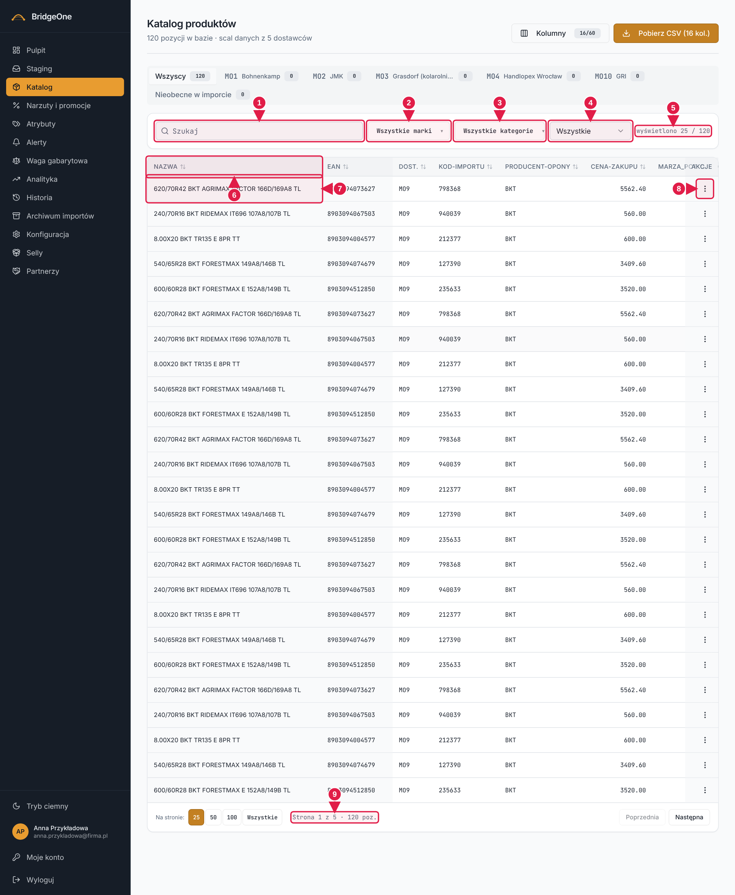
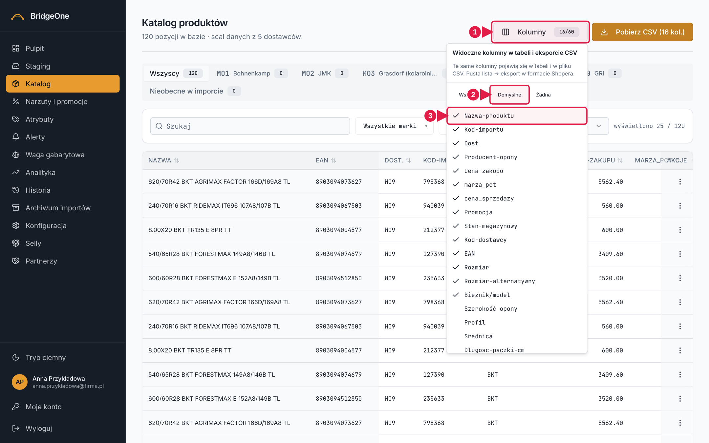
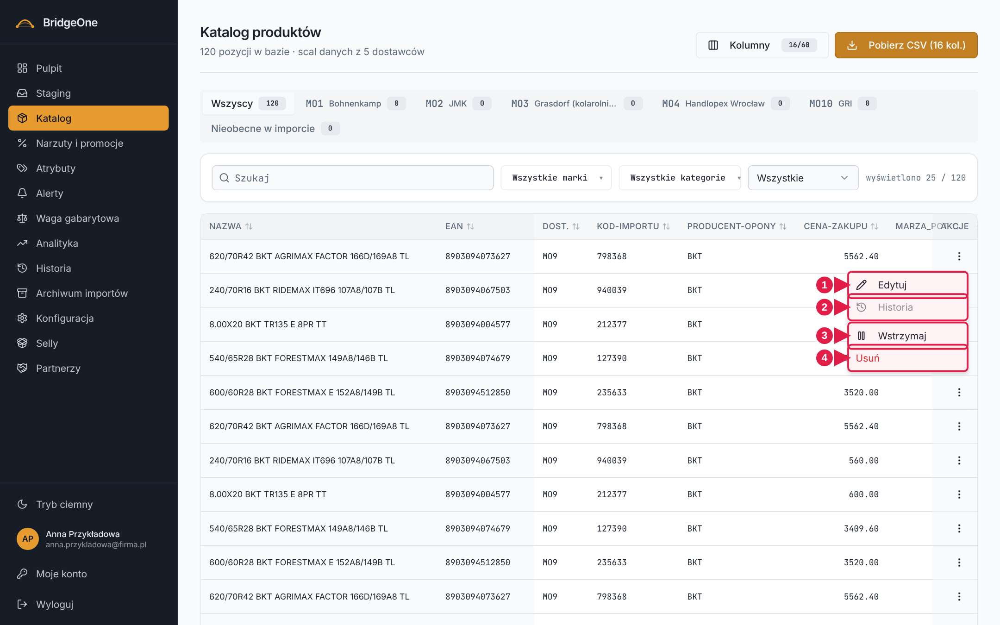
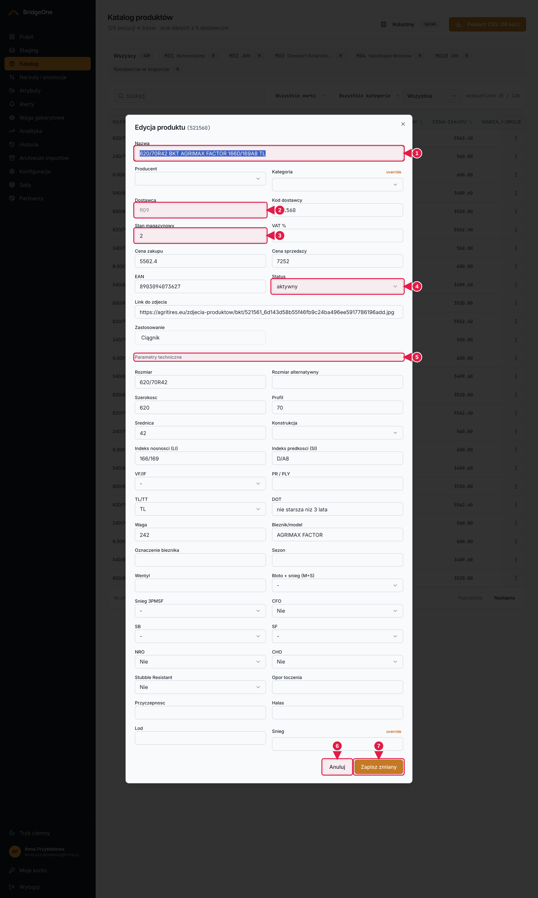

# Podręcznik Bridge — rozdział 3: Katalog

> Wersja robocza (2026-10-16). Konwencje i słownik kierunków (np. „prawy górny róg"): [rozdział 0](00-start-i-nawigacja.md).
>
> **Gdzie ćwiczyć:** ćwiczenia z oznaczeniem ⚠ **zmieniają dane**. Wykonuj je na **środowisku
> testowym: https://training.agroopony.eu**, nie na produkcji (`bridgeone.agroopony.eu`).
> Ćwiczenia bez ⚠ tylko oglądają dane i są bezpieczne wszędzie.

---

📍 **Jak tu wejść:** menu po lewej → **Katalog** (trzecia pozycja od góry, ikona pudełka). Skróty: kafelek „Produkty w katalogu" na Pulpicie.

---

## 1. Do czego służy Katalog

Katalog (menu po lewej → **Katalog**) to jedna wielka tabela wszystkich produktów (opon) zebranych
z cenników dostawców. Tu:

- **szukasz** produktu (po nazwie, EAN, kodzie, rozmiarze, marce…),
- **zawężasz** listę filtrami (dostawca, marka, kategoria, status),
- **sprawdzasz** ceny, stany, wagi, zdjęcia,
- **poprawiasz** pojedynczy produkt, **wstrzymujesz** go albo **usuwasz**,
- **pobierasz** wybrane dane jako plik CSV,
- **decydujesz**, co zrobić z pozycjami, które zniknęły z cennika dostawcy (zakładka „Nieobecne w imporcie").

> Nowe i zmienione pozycje z cenników **nie wpadają od razu do Katalogu** — najpierw czekają w zakładce
> **Staging** na akceptację. Katalog pokazuje to, co już zaakceptowane.

---

## 2. Jak wygląda ekran

Od góry:

1. **Nagłówek „Katalog produktów"** z podtytułem (liczba pozycji albo dane wybranego dostawcy) oraz
   dwoma przyciskami w **prawym górnym rogu**: **Kolumny** (obok niego mała plakietka np. `15/57`) i **Pobierz CSV**.
2. **Zakładki dostawców** — „Wszyscy", potem każdy dostawca (MO1, MO2…), na końcu
   „Nieobecne w imporcie". Każda ma **liczbę pozycji**. Czerwona kropka przy dostawcy = ostatni import
   zakończył się błędem; żółta = dostawca wstrzymany.
3. **Pasek filtrów** (biała karta pod zakładkami; od lewej): pole „Szukaj", listy „Marka" i „Kategoria", lista statusu, a po prawej licznik
   „wyświetlono X / Y".
4. **Tabela produktów.** Trzy kolumny są zawsze przyklejone do lewej: **Nazwa**, **EAN**, **Dostawca**.
   Na końcu każdego wiersza jest menu **⋮ (Akcje)**.
5. **Paginacja** — **na samym dole tabeli** (trzeba zjechać pod ostatni wiersz): po lewej „Na stronie: 25 / 50 / 100 / Wszystkie",
   po prawej **Poprzednia** i **Następna**. Pojawia się tylko, gdy wyników jest więcej niż na jednej stronie.

**Katalog — ekran główny (po zjechaniu na dół widać paginację)**

1. **Szukaj** — wpisuj, lista zawęża się na bieżąco
2. Lista **Marka** (zaznaczasz wiele)
3. Lista **Kategoria**
4. Lista **Status** (Dostępne, Brak EANu, Brak wagi…)
5. **Licznik** „wyświetlono X / Y"
6. **Nagłówek kolumny** — klik sortuje
7. **Nazwa** — klik rozwija pełną nazwę
8. **⋮ (Akcje)** — Edytuj / Wstrzymaj / Usuń
9. **Paginacja** — rozmiar strony i przyciski Poprzednia / Następna

---

## 3. Szukanie i filtrowanie

### Szukajka
Wpisz fragment tekstu — lista zawęża się od razu, bez klikania „Szukaj". Szukajka przeszukuje m.in.
kod, nazwę, kod dostawcy, EAN, markę, model, rozmiar, indeksy, DOT, kategorię i dostawcę.

- Możesz wpisać **kilka słów** — produkt musi zawierać **każde** z nich (w dowolnym polu), np.
  `michelin 315/80` znajdzie tylko Michelin w tym rozmiarze.
- Wielkość liter nie ma znaczenia. Szukany fragment może być w środku słowa.

### Zakładki dostawców
Kliknięcie dostawcy pokazuje tylko jego produkty. Zmiana zakładki czyści filtry marki i kategorii.

### Marka i Kategoria
To listy z **zaznaczaniem wielu pozycji** naraz. Napis na przycisku mówi, co wybrano: „Wszystkie marki",
nazwa jednej marki albo „3 marek". Listy zawierają tylko marki/kategorie występujące u wybranego dostawcy.

### Status
| Opcja | Co pokazuje |
|---|---|
| Wszystkie | bez ograniczeń |
| Dostępne (stan > 0) | tylko produkty ze stanem większym od zera (pozycje „na zamówienie" odpadają) |
| Aktywny / Wstrzymany | według statusu produktu |
| Brak EANu | produkty bez kodu EAN |
| Brak wagi | produkty bez wagi (lub z wagą 0) |
| Brak zdjęcia | produkty bez linku do zdjęcia |

Filtry **łączą się** (np. dostawca + marka + „Brak EANu").

### Ćwiczenia 3 — szukanie i filtry
1. Wejdź w **Katalog**. Odczytaj z podtytułu, ile pozycji jest w bazie.
2. W polu **Szukaj** wpisz fragment marki, którą znasz. Zobacz, jak zmienia się licznik „wyświetlono X / Y".
3. Dopisz po spacji rozmiar (np. `315/80`). Licznik powinien zmaleć. Wyczyść pole.
4. Kliknij zakładkę jednego dostawcy. Sprawdź, czy podtytuł pokazuje jego nazwę i adres e-mail.
5. Otwórz listę **Marka**, zaznacz **dwie** marki. Przycisk powinien pokazać „2 marek". Otwórz listę
   **Kategoria** i zaznacz jedną.
6. Zmień **Status** na **Brak EANu**. Ile pozycji zostało? Zapisz liczbę.
7. Wróć do zakładki **Wszyscy** — sprawdź, że filtry marki i kategorii się wyczyściły. Ustaw status na
   **Wszystkie**.

✅ *Umiesz, gdy:* potrafisz znaleźć wszystkie aktywne opony jednej marki od jednego dostawcy bez przewijania listy.

---

## 4. Tabela: sortowanie, nazwy, strony

- **Sortowanie:** kliknij nagłówek kolumny — lista sortuje się rosnąco; drugie kliknięcie odwraca
  kierunek. *Uwaga: Bridge nie pokazuje strzałki kierunku*, więc o kolejności przekonasz się, patrząc na dane.
- **Długie nazwy:** są ucinane. **Kliknij nazwę**, żeby ją rozwinąć w całości; kliknij jeszcze raz, żeby zwinąć.
  Najechanie myszką pokazuje też pełną nazwę w dymku.
- **Waga z ikoną:** przy niektórych wagach widać znaczek. **Ⓘ** = waga uzupełniona automatycznie na podstawie
  podobnego produktu (ta sama marka, rozmiar i bieżnik). **⚠ (żółty trójkąt)** = waga tylko **oszacowana**
  ze średniej dla rozmiaru — niepotwierdzona, warto ją sprawdzić. Najedź myszką, żeby przeczytać opis.
- **Pola Tak/puste:** w kolumnach typu M+S, NRO, CFO wartość „Tak" jest wypisana, a „nie" to puste pole.
- **Paginacja:** na dole wybierz **25 / 50 / 100 / Wszystkie** pozycji na stronie i przechodź przyciskami
  **Poprzednia / Następna**. Pod spodem widać „Strona X z Y · N poz.".

### Ćwiczenia 4 — tabela
1. Kliknij nagłówek **Nazwa**. Sprawdź, czy lista ułożyła się alfabetycznie. Kliknij ponownie — kolejność się odwraca.
2. Posortuj po **Cena zakupu**: najpierw rosnąco, potem malejąco. Znajdź najdroższy produkt.
3. Znajdź wiersz z długą, uciętą nazwą i **kliknij ją**, żeby zobaczyć całość. Kliknij ponownie.
4. Ustaw status **Brak wagi**, potem wróć na **Wszystkie** i poszukaj wagi z ikoną (Ⓘ lub ⚠). Najedź na nią i przeczytaj dymek.
5. Na dole przełącz **Na stronie: 25 → 100**, a potem **Wszystkie**. Zobacz, jak zmienia się „Strona X z Y".
6. Przewiń tabelę w prawo — sprawdź, że Nazwa, EAN i Dostawca zostają na miejscu.

✅ *Umiesz, gdy:* znajdziesz najtańszy i najdroższy produkt danego dostawcy w mniej niż minutę.

---

## 5. Wybór kolumn (przycisk „Kolumny")

📍 **Prawy górny róg** nagłówka strony → przycisk **Kolumny** (lewy z dwóch przycisków).

Tabela ma ponad 50 kolumn, ale domyślnie widać tylko najważniejsze (15). Przycisk **Kolumny** (z licznikiem
np. `16/57`) otwiera listę z haczykami:

- zaznacz/odznacz kolumnę, żeby ją pokazać/ukryć,
- **Wszystkie** — pokaż wszystkie, **Domyślne** — wróć do standardu, **Żadna** — odznacz wszystko.

Ważne:
- Wybrane kolumny są **zapamiętane w Twojej przeglądarce** — na innym komputerze lub przeglądarce zobaczysz
  ustawienia domyślne.
- **Te same kolumny trafiają do pliku CSV** (patrz niżej). Tabela i eksport zawsze się zgadzają.

**Lista „Kolumny"**

1. Przycisk **Kolumny** (z licznikiem 16/60)
2. **Wszystkie / Domyślne / Żadna**
3. **Haczyki** — zaznacz kolumnę, by ją pokazać

**Lista „Kolumny"**

1. Przycisk **Kolumny** (z licznikiem 16/60)
2. **Wszystkie / Domyślne / Żadna**
3. **Haczyki** — zaznacz kolumnę, by ją pokazać

### Ćwiczenia 5 — kolumny
1. Kliknij **Kolumny**. Odczytaj licznik na przycisku.
2. Zaznacz **Waga** i **Link-do-zdjecia**. Zamknij listę (kliknij poza nią) i przewiń tabelę w prawo — nowe kolumny są widoczne.
3. Odznacz **Promocja** i **Rozmiar-alternatywny**. Sprawdź, że zniknęły.
4. Kliknij **Domyślne** — wróć do standardowego widoku.
5. Odśwież stronę (F5). Zmień jedną kolumnę, odśwież ponownie — wybór powinien zostać zapamiętany.

✅ *Umiesz, gdy:* masz widok z kolumnami potrzebnymi do swojej pracy i wiesz, jak wrócić do domyślnego.

---

## 6. Edycja produktu ⚠

📍 **Na samym końcu wiersza** (po prawej stronie tabeli; przy szerokiej tabeli jest przyklejona do prawej krawędzi)
kliknij trzy pionowe kropki **⋮ (Akcje) → Edytuj**. Otwiera się okno **„Edycja produktu"**:

- **Góra:** Nazwa, Producent, Kategoria, Dostawca *(tylko do odczytu)*, Kod dostawcy, Stan magazynowy, VAT %,
  Cena zakupu, Cena sprzedaży, EAN, Status, Link do zdjęcia, Zastosowanie.
- **„Parametry techniczne":** rozmiar, szerokość/profil/średnica, konstrukcja, indeksy nośności i prędkości, TL/TT,
  DOT, waga, bieżnik/model, sezon, wentyl, oznaczenia (M+S, 3PMSF, CFO…) i etykiety (opór toczenia, hałas…).
- Producent, Kategoria, Sezon itd. wybierasz z **list słownikowych** (te same wartości, które zarządzane są
  w zakładce Atrybuty). Oznaczenia Tak/Nie mają listę „- / Tak / Nie".
- **Zastosowanie** to lista z haczykami — możesz wybrać kilka pozycji naraz (zależą od kategorii produktu).

Przyciski u dołu: **Anuluj** (nic się nie zapisuje) i **Zapisz zmiany**. Zapisywane są **tylko pola, które zmieniłaś/eś**.
Po zapisie pojawia się komunikat „Zapisano zmiany".

### Znaczek „override" — poprawka ręczna
Każda zapisana ręcznie zmiana pola staje się **poprawką ręczną**: kolejny import cennika **jej nie nadpisze**.
Przy takim polu w oknie edycji pojawia się mały przycisk **override**. Kliknięcie go **zdejmuje poprawkę** —
od następnego importu pole znów będzie brane z pliku dostawcy.

> ⚠ **Uważaj przy zmianie nazwy.** Nazwa produktu przechodzi przez pamięć nazw i poprawki ręczne, więc po
> kolejnym imporcie lub akceptacji w Stagingu może zachować się inaczej, niż się spodziewasz. Zmieniaj nazwy
> świadomie i najpierw przećwicz na środowisku testowym.

**Menu ⋮ (Akcje) w wierszu**

1. **Edytuj** — okno edycji produktu
2. **Historia** — wyszarzona (nieaktywna)
3. **Wstrzymaj / Aktywuj**
4. **Usuń** (czerwone)

**Okno „Edycja produktu"**

1. Pole **Nazwa**
2. **Dostawca** — wyszarzone, nie do zmiany
3. **Stan magazynowy** — pole liczbowe
4. **Status** — lista aktywny / wstrzymany
5. **Parametry techniczne**
6. **Anuluj** — zamyka bez zapisu
7. **Zapisz zmiany**

### Ćwiczenia 6 — edycja ⚠ (tylko środowisko testowe)
1. Znajdź dowolny produkt (szukajką). Kliknij **⋮ → Edytuj**.
2. Zwróć uwagę, że pole **Dostawca** jest wyszarzone — nie da się go zmienić.
3. Zmień **Stan magazynowy** na inną liczbę. Kliknij **Anuluj**. Sprawdź w tabeli, że stan się **nie** zmienił.
4. Otwórz edycję ponownie, zmień **Stan magazynowy**, kliknij **Zapisz zmiany**. Sprawdź komunikat i nową wartość w tabeli.
5. Otwórz ten sam produkt jeszcze raz — obok zmienionego pola powinien być przycisk **override**. Najedź na niego, przeczytaj dymek.
6. Kliknij **override**, aby zdjąć poprawkę. Przycisk powinien zniknąć.
7. Wypróbuj pole z listą: zmień **Sezon** albo **Producent** z rozwijanej listy. Zapisz.
8. Wypróbuj **Zastosowanie**: zaznacz dwie pozycje na liście i zapisz. Zobacz wynik w kolumnie „Zastosowanie".
9. (opcjonalnie) Wejdź w **Historia** w menu bocznym i znajdź swoje zmiany.

✅ *Umiesz, gdy:* potrafisz zmienić wartość, wycofać okno bez zapisu i wiesz, co oznacza „override".

---

## 7. Wstrzymanie i aktywacja produktu ⚠

📍 **⋮ (Akcje)** na końcu wiersza → **Wstrzymaj** / **Aktywuj** (trzecia pozycja menu, pod linią oddzielającą).

**⋮ → Wstrzymaj** zmienia status produktu na „wstrzymany"; ta sama pozycja menu dla wstrzymanego produktu
nazywa się **Aktywuj** i przywraca status „aktywny". Nie ma potwierdzenia — efekt widać od razu
(komunikat „Wstrzymano" / „Aktywowano" i zmiana w kolumnie *status*).

Status możesz też zmienić w oknie edycji (pole **Status**).

### Ćwiczenia 7 — status ⚠ (tylko środowisko testowe)
1. Wybierz aktywny produkt. Kliknij **⋮ → Wstrzymaj**. Sprawdź komunikat i kolumnę *status* (dodaj ją w „Kolumny", jeśli jej nie widać).
2. Ustaw filtr **Status → Wstrzymany** i znajdź ten produkt.
3. Kliknij **⋮ → Aktywuj**. Produkt powinien zniknąć z listy wstrzymanych (po odświeżeniu filtra) i wrócić do aktywnych.

---

## 8. Usuwanie produktu ⚠

📍 **⋮ (Akcje)** na końcu wiersza → **Usuń** (ostatnia, czerwona pozycja menu).

**⋮ → Usuń** (czerwone) pyta: *„Usunąć [kod]?"*. **Usuń** potwierdza, **Anuluj** zamyka okno.
Po usunięciu pojawia się komunikat „Usunięto produkt". **Tej operacji nie cofniesz z poziomu Katalogu** —
rób to rozważnie.

> Jeśli chcesz tylko „schować" produkt, **wstrzymaj** go zamiast usuwać.

### Ćwiczenia 8 — usuwanie ⚠ (tylko środowisko testowe)
1. Kliknij **⋮ → Usuń** przy dowolnym produkcie. Przeczytaj pytanie.
2. Kliknij **Anuluj**. Sprawdź, że produkt nadal jest na liście.
3. Dopiero na środowisku testowym: ponów, tym razem potwierdź **Usuń**, i sprawdź, że licznik pozycji w zakładce zmalał o 1.

---

## 9. Pobieranie CSV (przycisk „Pobierz CSV")

📍 **Prawy górny róg** nagłówka strony → przycisk **Pobierz CSV** (prawy z dwóch przycisków). Plik zapisze się w folderze „Pobrane" Twojej przeglądarki.

Przycisk po prawej w nagłówku pobiera plik CSV z produktami **aktualnie wybranej zakładki dostawcy**
(albo wszystkich, gdy jesteś na „Wszyscy").

- **Kolumny w pliku = kolumny wybrane w „Kolumny"** (przycisk pokazuje ich liczbę: „Pobierz CSV (15 kol.)").
- Nazwa pliku: `katalog_<dostawca>_wybrane_<data>.csv`. Separator to średnik `;`.
- ⚠ **Filtry (szukajka, marka, kategoria, status) NIE zawężają eksportu** — liczy się tylko zakładka dostawcy.
- Pozycje **bez ceny zakupu lub bez ceny sprzedaży** są pomijane (nie ma ich w pliku).
- Jeśli odznaczysz **wszystkie** kolumny („Żadna"), przycisk zmienia się na „Pobierz CSV (Shoper)" i plik ma
  format importu do Shopera.

### Ćwiczenia 9 — eksport
1. Wybierz zakładkę jednego dostawcy.
2. W **Kolumny** kliknij **Domyślne**. Przycisk eksportu powinien pokazać liczbę kolumn.
3. Kliknij **Pobierz CSV**. Poczekaj na komunikat „Eksport gotowy" — odczytaj liczbę produktów i nazwę pliku.
4. Otwórz plik w Excelu/LibreOffice (separator: średnik). Policz kolumny — zgadzają się z licznikiem?
5. Wróć do Bridge, wpisz coś w **Szukaj** (np. nazwę marki) i pobierz CSV jeszcze raz. Porównaj liczbę wierszy
   z poprzednim plikiem — powinna być taka sama (filtr nie wpływa na eksport).

✅ *Umiesz, gdy:* pobierzesz plik z dokładnie tymi kolumnami, których potrzebujesz.

---

## 10. Zakładka „Nieobecne w imporcie" ⚠

📍 Rząd zakładek pod nagłówkiem → **ostatnia zakładka po prawej** („Nieobecne w imporcie" z liczbą na plakietce). Pod zakładką zamiast filtrów katalogu pojawia się własny opis, dwa przyciski i tabela.

Gdy produkt przez kilka dni nie pojawia się w cenniku dostawcy (domyślnie **7 dni**, dla dostawców z cennikiem
rocznym — od razu), system **wstrzymuje go automatycznie** i umieszcza na tej liście do decyzji. Licznik na zakładce
mówi, ile pozycji czeka.

Dla każdej pozycji widzisz: dostawcę, kod, nazwę, EAN, datę wstrzymania i **liczbę dni bez pozycji w pliku**.

Możesz:
- zaznaczyć pozycje haczykami (lub **wszystkie** haczykiem w nagłówku) i
  - **Przywróć jako aktywne** — produkt wraca na aktywne. *Działa tylko do następnego importu:* jeśli pozycji nadal
    nie ma w pliku dostawcy, system wstrzyma ją ponownie i wróci tu po upływie progu.
  - **Usuń** — usuwa pozycję z Katalogu; **karta produktu zostaje zapisana w archiwum**. Jeśli pozycja jest w Selly,
    jej produkt trafi do usunięcia po kontroli tożsamości.
- Przyciski są nieaktywne, dopóki nic nie zaznaczysz; na każdym widać liczbę zaznaczonych, np. „Usuń (3)".
- Każda akcja prosi o potwierdzenie.

### Ćwiczenia 10 — nieobecne ⚠ (środowisko testowe)
1. Kliknij zakładkę **Nieobecne w imporcie**. Przeczytaj opis na górze i odczytaj próg dni.
2. Jeśli lista jest pusta, zobaczysz „Brak pozycji do decyzji" — to dobra wiadomość; ćwiczenie możesz pominąć.
3. Zaznacz jedną pozycję. Zwróć uwagę, że przyciski pokazują „(1)".
4. Kliknij **Przywróć jako aktywne**, przeczytaj pytanie i potwierdź. Odczytaj komunikat u góry.
5. Zaznacz kolejną pozycję, kliknij **Usuń** i przeczytaj ostrzeżenie — potem **Anuluj** (usuwaj tylko wtedy, gdy
   faktycznie tak zdecydujesz).
6. Użyj haczyka w nagłówku, żeby zaznaczyć wszystkie, a potem odznacz go.

---

## 11. Najczęstsze pytania

**Zmieniłam/em produkt, a po imporcie wrócił do starej wartości.** Zmiana mogła nie zostać zapisana jako poprawka
ręczna albo została zdjęta przyciskiem *override*. Zmień pole jeszcze raz i zapisz.

**Nie widzę nowego produktu od dostawcy.** Sprawdź zakładkę **Staging** — nowe pozycje czekają tam na akceptację.

**Brakuje kolumny, którą pamiętam.** Sprawdź w **Kolumny**, czy jest zaznaczona; wybór jest zapisany w przeglądarce
i nie przenosi się między komputerami.

**Lista jest pusta po wybraniu dostawcy.** Dostawca może być wstrzymany lub ostatni import skończył się błędem
(kolorowa kropka na zakładce) — zajrzyj do **Alertów**.

**Plik CSV ma mniej produktów niż tabela.** Pomijane są pozycje bez ceny zakupu lub sprzedaży (patrz sekcja 9).

---

## Skrót — co kliknąć, żeby…

| Chcę… | Kliknij |
|---|---|
| znaleźć produkt | pole **Szukaj** |
| zobaczyć tylko jednego dostawcę | jego **zakładkę** |
| zobaczyć produkty bez EAN / wagi / zdjęcia | **Status** → Brak EANu / wagi / zdjęcia |
| zmienić kolejność | **nagłówek kolumny** |
| zobaczyć więcej kolumn | **Kolumny** |
| poprawić produkt | **⋮ → Edytuj** |
| wycofać produkt z oferty bez usuwania | **⋮ → Wstrzymaj** |
| usunąć produkt | **⋮ → Usuń** |
| pobrać plik | **Pobierz CSV** |
| rozstrzygnąć pozycje, które zniknęły z cennika | zakładka **Nieobecne w imporcie** |
