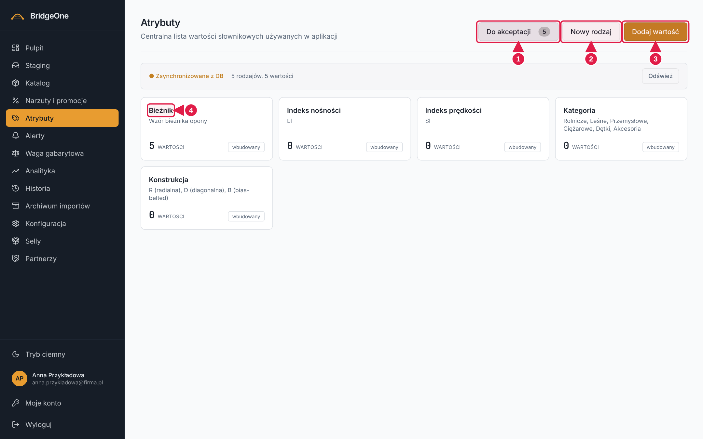
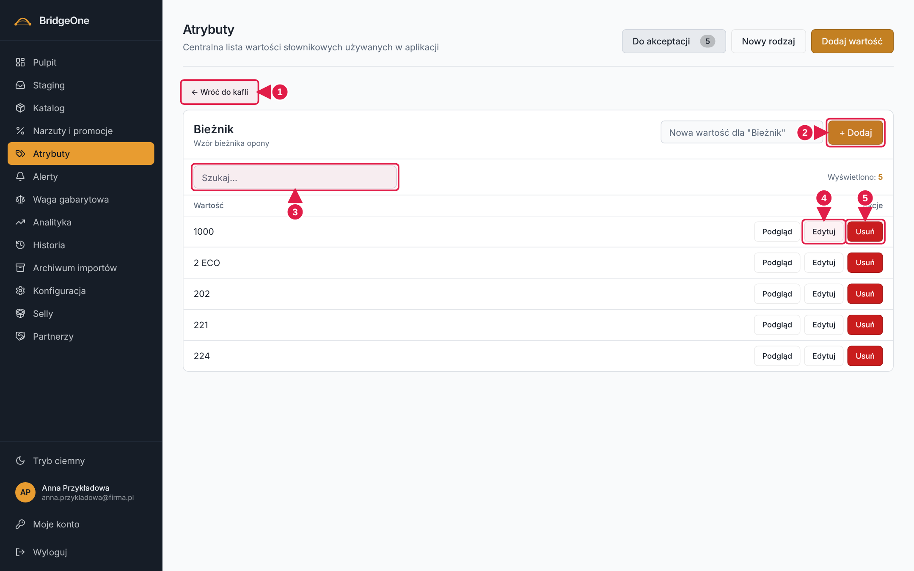
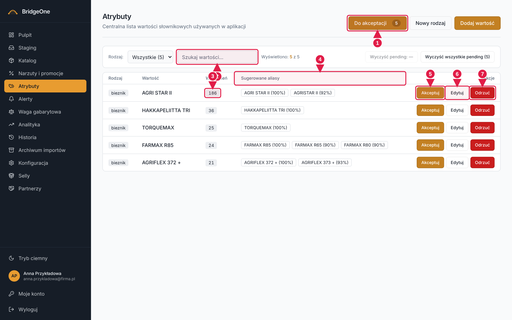

# Podręcznik Bridge — rozdział 5: Atrybuty

> Wersja robocza (2026-10-16). Konwencje: [rozdział 0](00-start-i-nawigacja.md).
> ⚠ Edycja i akceptacja wartości **przepisuje produkty w całym katalogu**. Ćwiczenia — tylko na środowisku testowym
> (**https://training.agroopony.eu**).

📍 **Jak tu wejść:** menu po lewej → **Atrybuty** (piąta pozycja od góry, ikona metek).

## Do czego służy

Atrybuty to **słowniki dozwolonych wartości**: marki, kategorie, sezony, indeksy nośności itd. Z tych list korzystają
Katalog (filtry i okno edycji), Narzuty (warunki) i import. Dzięki słownikom „ALLIANCE" i „Alliance" nie są dwiema markami.

Nowe wartości znalezione w cennikach dostawców trafiają do **kolejki „Do akceptacji"** — Ty decydujesz,
czy dodać je do słownika, poprawić, zmapować jako alias albo odrzucić.

## Jak wygląda ekran

1. **Nagłówek „Atrybuty"**, a w **prawym górnym rogu** trzy przyciski (od lewej): **Do akceptacji** (z liczbą w kółku),
   **Nowy rodzaj**, **Dodaj wartość**.
2. Poniżej **kafle rodzajów** (np. Marka, Kategoria, Sezon…), każdy z liczbą wartości. Kliknięcie kafla otwiera
   panel jego wartości. Na dole mogą być „Sieroty w DB" — wartości, dla których nie ma rodzaju.
3. Gdy otworzysz rodzaj: u góry link **← Wróć do kafli**, pole „Nowa wartość…", szukajka i tabela
   (Wartość + Akcje: ikona podglądu, **Edytuj**, **Usuń**).

**Atrybuty — kafle rodzajów**

1. **Do akceptacji** (liczba = kolejka)
2. **Nowy rodzaj**
3. **Dodaj wartość**
4. **Kafel rodzaju** — klik otwiera wartości

## 1. Przeglądanie wartości

**Panel wartości wybranego rodzaju**

1. **← Wróć do kafli**
2. Pole **Nowa wartość** i **+ Dodaj**
3. **Szukaj**
4. **Edytuj**
5. **Usuń**

### ✍️ Ćwiczenia 5.1
1. Menu po lewej → **Atrybuty**. Odczytaj, ile rodzajów (kafli) widzisz.
2. Kliknij kafel **Marka**. Wpisz w „Szukaj…" fragment marki, np. `alli`.
3. W wierszu kliknij **ikonę podglądu** (podpowiedź: „Zobacz produkty używające tej wartości"). W oknie
   „Produkty używające atrybutu" zobaczysz listę produktów (Dostawca, Kod, Nazwa, Marka, Rozmiar, Stan). Zamknij okno.
4. Kliknij **← Wróć do kafli**.

## 2. Dodawanie wartości i rodzaju ⚠

- **Dodaj wartość** (prawy górny róg): okno „Nowy atrybut" → wybierz **Rodzaj**, wpisz **Wartość** → zapisz.
  Jeśli wartość już istnieje, dostaniesz komunikat „Już istnieje".
- Albo wewnątrz otwartego rodzaju: wpisz w polu „Nowa wartość…" i kliknij **+ Dodaj**.
- **Nowy rodzaj** (prawy górny róg): okno z polami **Nazwa** (np. „Sezon") i **Opis** (opcjonalnie) → **Utwórz rodzaj**.

### ✍️ Ćwiczenia 5.2 ⚠ (środowisko testowe)
1. Kliknij **Nowy rodzaj**. Nazwa: `Test`, opis: `ćwiczenie`. Kliknij **Utwórz rodzaj**. Znajdź nowy kafel.
2. Wejdź w kafel „Test". W polu „Nowa wartość…" wpisz `Wartość A` i kliknij **+ Dodaj**.
3. Dodaj w ten sam sposób `Wartość B`. Spróbuj dodać `Wartość A` ponownie — przeczytaj komunikat.
4. Wróć do kafli i kliknij **Dodaj wartość** (prawy górny róg). Wybierz rodzaj „Test", wpisz `Wartość C`.

## 3. Edycja i usuwanie wartości ⚠

W wierszu wartości: **Edytuj** — zmienia pisownię wartości **we wszystkich produktach, które jej używają**;
**Usuń** — pyta „Usunąć wartość … z rodzaju …?".

### ✍️ Ćwiczenia 5.3 ⚠
1. W rodzaju „Test" przy `Wartość B` kliknij **Edytuj**, zmień na `Wartość B2`, zatwierdź.
2. Przy `Wartość C` kliknij **Usuń** i potwierdź. Sprawdź, że zniknęła.

## 4. Kolejka „Do akceptacji" (pending) ⚠

📍 **Prawy górny róg** → przycisk **Do akceptacji** (liczba w kółku = ile pozycji czeka). Kliknij ponownie, aby wrócić do kafli.

Tabela: **Rodzaj, Wartość, Wystąpień** (w ilu produktach), **Sugerowane aliasy** (podobne istniejące wartości
albo „brak podobnych"), **Akcje**. Nad tabelą: szukajka „Szukaj wartości…", filtr rodzaju i przyciski
**Wyczyść pending…**. **Kliknięcie liczby w kolumnie „Wystąpień"** pokazuje produkty z tą wartością w katalogu. Podpowiedzi aliasów to małe przyciski z nazwą i procentem podobieństwa, np. `Rolnicze (92%)`.

Trzy decyzje na każdej pozycji:
| Przycisk | Skutek |
|---|---|
| **Akceptuj** | wartość trafia do słownika bez zmian |
| **Edytuj** (akceptuj z edycją) | wpisujesz poprawną pisownię; wartość trafia do słownika, a **wszystkie produkty z tą wartością zostają przepisane**. Okno ostrzega o skali i mówi, że wpis pojawi się w Historii (typ „edycja") |
| **Odrzuć** | wartość ląduje na liście odrzuconych; kolejne skany ją pomijają. Możesz podać powód |
| (kliknięcie przycisku z podpowiedzią w kolumnie „Sugerowane aliasy") **Akceptuj jako alias** | wartość nie wchodzi do słownika, ale produkty zostają przepisane na wskazaną wartość kanoniczną |

> **Czytaj podpowiedzi uważnie** — podpowiedź bywa zapisana innymi literami (np. „Farmax R75" zamiast „FARMAX R75")
> i akceptacja przepisze wszystkie pasujące produkty na tę formę.
>
> **Wyczyść pending** to nie trwałe odrzucenie: jeśli te same wartości pojawią się w kolejnym imporcie, wrócą do kolejki.

**Kolejka „Do akceptacji"**

1. **Do akceptacji** — klik wraca do kafli
2. **Szukaj wartości**
3. **Wystąpień** — klik pokazuje produkty
4. **Sugerowane aliasy**
5. **Akceptuj**
6. **Edytuj** (akceptuj z poprawką)
7. **Odrzuć**

### ✍️ Ćwiczenia 5.4 ⚠ (środowisko testowe)
1. Kliknij **Do akceptacji** (prawy górny róg). Odczytaj liczbę pozycji.
2. Wpisz w „Szukaj wartości…" fragment jednej pozycji. Kliknij liczbę w kolumnie **Wystąpień** — zobaczysz produkty z tą wartością.
3. Zaakceptuj jedną pozycję przyciskiem **Akceptuj** — zniknie z kolejki. Sprawdź w kaflu odpowiedniego rodzaju, że wartość jest w słowniku.
4. Przy innej pozycji kliknij **Edytuj**, popraw pisownię, przeczytaj ostrzeżenie o skali i zatwierdź. Wejdź potem w **Historia → filtr „Edycje"** i znajdź wpis.
5. Przy trzeciej pozycji kliknij **Odrzuć**, wpisz powód i zatwierdź.
6. Kliknij **Do akceptacji** ponownie, aby wrócić do kafli.

✅ *Umiesz, gdy:* rozumiesz różnicę między „Akceptuj", „Edytuj", alias i „Odrzuć" i wiesz, że edycja przepisuje produkty.
