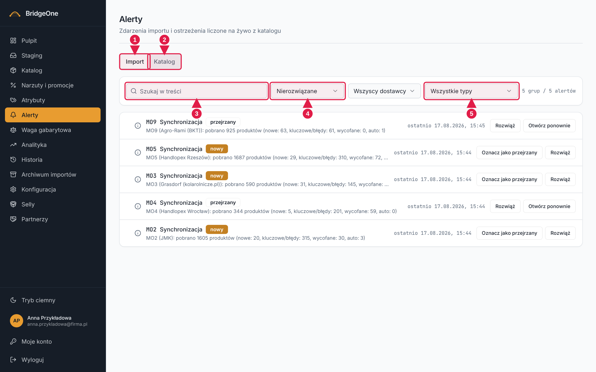
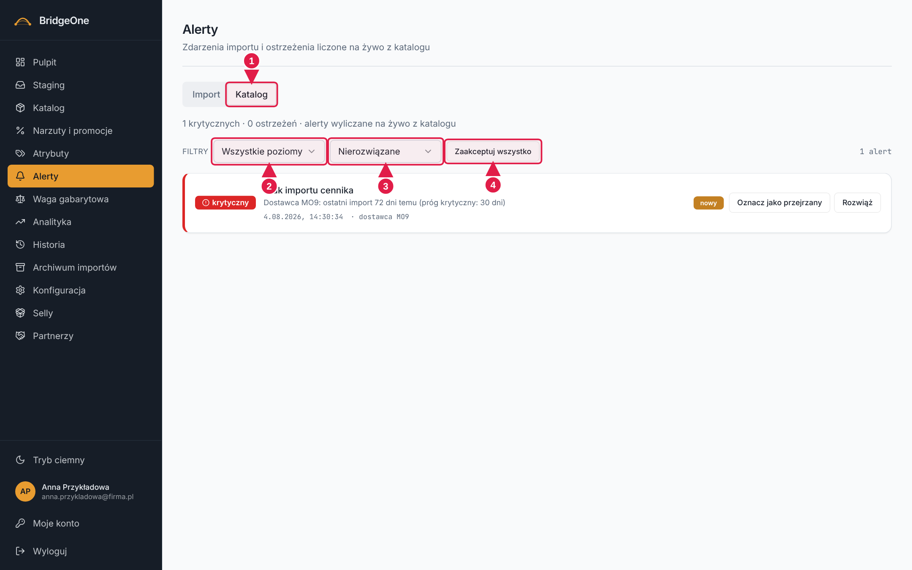

# Podręcznik Bridge — rozdział 6: Alerty

> Konwencje: [rozdział 0](00-start-i-nawigacja.md).
> Zmiana statusu alertu nie zmienia katalogu, ale jest zapisywana. Zalecamy środowisko testowe
> (**https://training.agroopony.eu**); oglądanie jest bezpieczne wszędzie.

📍 **Jak tu wejść:** menu po lewej → **Alerty** (szósta pozycja od góry, ikona dzwonka). Skróty: kafelek „Aktywne alerty"
albo link „Zobacz wszystkie" na Pulpicie.

## Do czego służy

Alerty to ostrzeżenia, które system sam wykrywa. Dwa rodzaje, każdy w osobnej zakładce:
- **Import** — zdarzenia z pobierania cenników (błąd HTTP, błąd pobierania, ręczny upload, pusty plik…).
- **Katalog** — liczone **na żywo** z danych: ujemna marża (sprzedaż pod kosztem), bardzo niska marża,
  pozycja uznana za nie-oponę, dostawca, od którego długo nie przyszedł cennik.

Alert ma trzy stany: **nowy → przejrzany → rozwiązany**.

## Jak wygląda ekran

Nagłówek „Alerty" (podtytuł: „Zdarzenia importu i ostrzeżenia liczone na żywo z katalogu"), pod nim dwie
**zakładki: Import** (domyślna) i **Katalog**.

## 1. Zakładka „Import"

**Pasek filtrów:** pole **Szukaj w treści**, lista **Status** (domyślnie „Nierozwiązane" = nowe + przejrzane;
dalej „Wszystkie statusy" i poszczególne stany), lista **Dostawca** i lista **Typ**.

**Lista** jest **pogrupowana** (dostawca + typ). Kliknięcie wiersza grupy (strzałka z lewej) **rozwija** ją i pokazuje
pojedyncze wpisy z datami. Po prawej każdej grupy/wpisu są przyciski zmiany stanu:
- **Oznacz jako przejrzany** (dla nowych),
- **Rozwiąż**,
- **Otwórz ponownie** (dla rozwiązanych — cofa pomyłkę).

Można też zaznaczyć wiele alertów i zmienić status hurtem; komunikat mówi, ile alertów zmieniono.

**Alerty — zakładka Import**

1. Zakładka **Import** (domyślna)
2. Zakładka **Katalog**
3. **Szukaj w treści**
4. **Status** (domyślnie Nierozwiązane)
5. **Typ** alertu

### ✍️ Ćwiczenia 6.1 — alerty z importu ⚠ (środowisko testowe)
1. Menu po lewej → **Alerty**. Upewnij się, że otwarta jest zakładka **Import**.
2. Zmień **Status** na „Wszystkie statusy" i zobacz, ile się zmieniło w liczbie wpisów. Wróć do „Nierozwiązane".
3. Z listy **Dostawca** wybierz jednego dostawcę; z listy **Typ** — jeden typ błędu.
4. W polu **Szukaj w treści** wpisz `błąd` — sprawdź, że lista się zawęża. Wyczyść pole.
5. Rozwiń jedną grupę strzałką po lewej. Przeczytaj treść wpisu.
6. Kliknij **Oznacz jako przejrzany**. Zobacz komunikat „Status alertu zmieniony".
7. Kliknij **Rozwiąż**. Alert znika z widoku „Nierozwiązane".
8. Zmień Status na „Wszystkie statusy", znajdź ten alert i kliknij **Otwórz ponownie**.

## 2. Zakładka „Katalog"

📍 Pod nagłówkiem → zakładka **Katalog** (druga, na prawo od „Import").

**Pasek filtrów** ma podpis „Filtry" i listy **Poziom** (Wszystkie poziomy / Krytyczny / Ostrzeżenie / Info) oraz **Status**.
Na pasku jest też przycisk **Zaakceptuj wszystko** — rozwiązuje od razu **wszystkie widoczne alerty, bez pytania
o potwierdzenie**. Pomyłkę cofasz po jednym, przyciskiem **Otwórz ponownie**.

Każdy alert ma kolorowy pasek poziomu i opis, np. „KOD · Nazwa (marża -3,2%, zakup 100 zł, sprzedaż 97 zł)".
Dzięki temu od razu wiadomo, który produkt poprawić (w **Katalogu**: **⋮ → Edytuj** albo zmiana narzutu w **Narzutach**).

**Alerty — zakładka Katalog**

1. Zakładka **Katalog**
2. Lista **Poziom** (Krytyczny / Ostrzeżenie / Info)
3. Lista **Status**
4. **Zaakceptuj wszystko** — rozwiązuje wszystkie widoczne, bez pytania

### ✍️ Ćwiczenia 6.2 — alerty katalogowe ⚠ (środowisko testowe)
1. W Alertach kliknij zakładkę **Katalog**. Poczekaj na „Liczenie alertów z katalogu…".
2. Ustaw **Poziom → Krytyczny**. Przeczytaj opis pierwszego alertu — jaka jest marża?
3. Skopiuj kod produktu z opisu, wejdź w **Katalog** i wyszukaj go. Sprawdź cenę zakupu i sprzedaży.
4. Wróć do Alertów → Katalog. Przy tym alercie zmień status na „przejrzany".
5. Ustaw Status = „Nierozwiązane" i Poziom = „Wszystkie poziomy". Nie klikaj **Zaakceptuj wszystko**, jeśli nie chcesz rozwiązać
   wszystkich naraz — to ćwiczenie tylko na środowisku testowym.
6. Wróć na **Pulpit** i sprawdź, czy liczba na kafelku „Aktywne alerty" się zmieniła.

✅ *Umiesz, gdy:* potrafisz znaleźć konkretny alert, przeczytać jego przyczynę i oznaczyć go jako przejrzany lub rozwiązany.
