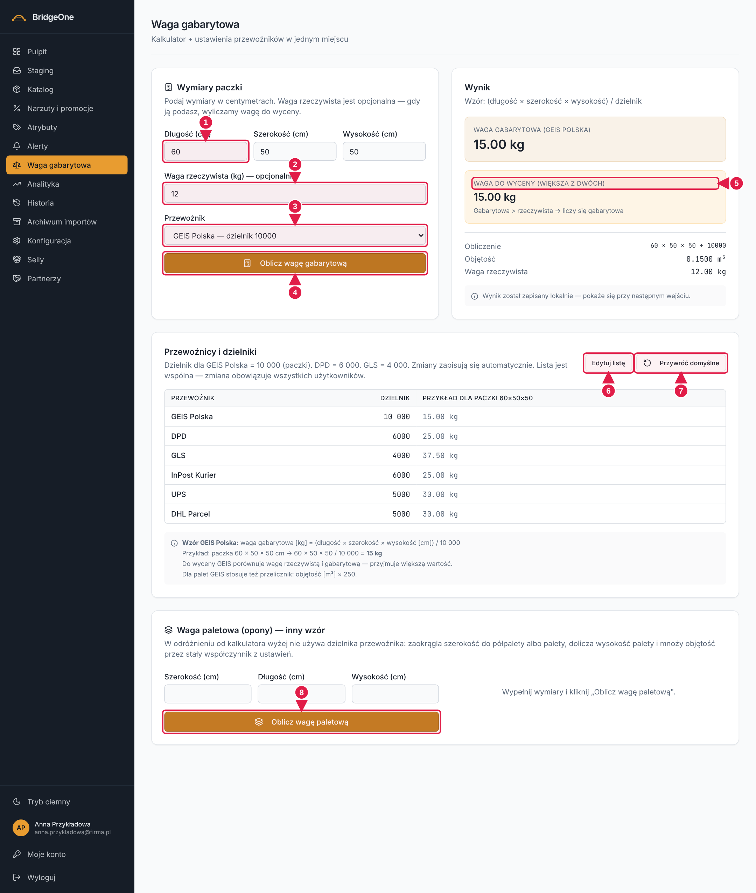

# Podręcznik Bridge — rozdział 7: Waga gabarytowa

> Wersja robocza (2026-10-16). Konwencje: [rozdział 0](00-start-i-nawigacja.md).
> ⚠ **Lista przewoźników jest wspólna dla wszystkich użytkowników** — jej zmiana (dodanie, usunięcie, nowy dzielnik)
> widzi cała firma. Ćwiczenia modyfikujące listę rób na środowisku testowym (**https://training.agroopony.eu**).

📍 **Jak tu wejść:** menu po lewej → **Waga gabarytowa** (siódma pozycja od góry, ikona wagi).

## Do czego służy

Przewoźnicy liczą cenę przesyłki z **większej z dwóch wag**: rzeczywistej albo **gabarytowej**
(objętość paczki ÷ dzielnik przewoźnika). Ten ekran liczy tę wagę za Ciebie i przechowuje listę przewoźników z dzielnikami.

Wzór: **waga gabarytowa [kg] = długość × szerokość × wysokość [cm] ÷ dzielnik**. Np. paczka 60 × 50 × 50 cm
u GEIS-a (dzielnik 10 000) = **15 kg**.

## Jak wygląda ekran (od góry do dołu)

1. **Nagłówek** „Waga gabarytowa".
2. **Kalkulator** — pola Długość, Szerokość, Wysokość (cm), Waga rzeczywista (kg, opcjonalnie), lista **Przewoźnik**
   i przycisk **Oblicz wagę gabarytową**. Wynik pojawia się obok/pod kalkulatorem: waga gabarytowa, **waga do wyceny**
   (większa z dwóch), objętość.
3. **Lista przewoźników** (karta niżej): tabela Przewoźnik / Dzielnik / Przykład dla paczki 60×50×50;
   przyciski **Edytuj listę** (a po kliknięciu — **Gotowe**) oraz **Przywróć domyślne**.
4. **Na samym dole strony** — drugi kalkulator **„Waga paletowa (opony)"**, liczony innym wzorem.

**Waga gabarytowa — cały ekran (po wpisaniu przykładowych wymiarów)**

1. **Długość / Szerokość / Wysokość** w cm
2. **Waga rzeczywista** (opcjonalnie)
3. Lista **Przewoźnik**
4. **Oblicz wagę gabarytową**
5. **Wynik** — waga do wyceny to większa z dwóch
6. **Edytuj listę** przewoźników
7. **Przywróć domyślne**
8. **Waga paletowa** — drugi kalkulator, na dole strony

## 1. Kalkulator

### ✍️ Ćwiczenia 7.1
1. Menu po lewej → **Waga gabarytowa**. W pierwszej karcie wpisz Długość `60`, Szerokość `50`, Wysokość `50`.
2. Z listy **Przewoźnik** wybierz **GEIS Polska** i kliknij **Oblicz wagę gabarytową**. Wynik: **15 kg**.
3. Zmień przewoźnika na **DPD** i kliknij ponownie — **25 kg**. Zmień na **GLS** — **37,50 kg**.
4. Wpisz **Wagę rzeczywistą** `30` i oblicz. Odczytaj „Waga do wyceny (większa z dwóch)" i adnotację, która waga wygrała.
5. Wyczyść wysokość i kliknij oblicz — przeczytaj komunikat „Niepoprawne wymiary".

## 2. Lista przewoźników ⚠

📍 Karta pod kalkulatorem, z tabelą przewoźników.

- **Edytuj listę** przełącza tabelę w tryb edycji: w kolumnach pojawiają się pola do zmiany nazwy i dzielnika oraz
  kolumna **Akcje** (kosz). Poniżej jest formularz **„Dodaj nowego przewoźnika"** (nazwa + dzielnik).
  Zmiany zapisują się **automatycznie**. Przycisk zmienia się na **Gotowe** — kliknij go, aby zamknąć edycję.
- **Usuwanie** pyta o potwierdzenie; jeśli usuwasz przewoźnika wybranego w kalkulatorze, okno mówi, na którego się przełączy.
  Musi zostać co najmniej jeden przewoźnik.
- **Przywróć domyślne** — wraca sześć domyślnych: GEIS Polska, DPD, GLS, InPost Kurier, UPS, DHL Parcel.
  Dodani przewoźnicy i poprawione dzielniki znikną u wszystkich.

### ✍️ Ćwiczenia 7.2 ⚠ (środowisko testowe)
1. Kliknij **Edytuj listę**. W formularzu „Dodaj nowego przewoźnika" wpisz Nazwa `Pocztex`, Dzielnik `5000`; kliknij dodaj.
2. Kliknij **Gotowe**. Sprawdź, że Pocztex jest w tabeli i w liście **Przewoźnik** kalkulatora.
3. Policz paczkę 60×50×50 dla Pocztexu (oczekiwane: 30 kg).
4. Odśwież stronę (F5) — Pocztex ma pozostać. Otwórz panel w innej przeglądarce — też powinien tam być.
5. Wybierz w kalkulatorze Pocztex, wejdź w **Edytuj listę**, kliknij kosz przy Pocztexie. Przeczytaj ostrzeżenie i potwierdź **Usuń przewoźnika**.
6. Kliknij **Przywróć domyślne**, przeczytaj pytanie i **Anuluj** (nie potwierdzaj, jeśli zależy Ci na zmienionej liście).

## 3. Kalkulator paletowy

📍 **Zjedź na sam dół strony** → karta **„Waga paletowa (opony) — inny wzór"**.

Nie używa dzielnika przewoźnika: zaokrągla szerokość do półpalety lub palety, dolicza wysokość palety i mnoży objętość
przez stały współczynnik (dla palet GEIS: objętość [m³] × 250). Wpisz wymiary i kliknij **Oblicz wagę paletową**.

### ✍️ Ćwiczenia 7.3
1. Zjedź na dół strony do karty „Waga paletowa".
2. Wpisz Szerokość `120`, Długość `80`, Wysokość `100` (cm) i kliknij **Oblicz wagę paletową**.
3. Przeczytaj: „Szerokość do wyliczenia", „Wysokość z paletą", „Współczynnik" i wynik **Waga gabarytowa paletowa**.
4. Zmień wysokość na `150` i porównaj wyniki.

✅ *Umiesz, gdy:* policzysz wagę do wyceny dla dowolnej paczki i wiesz, że zmiana listy przewoźników dotyczy całej firmy.
