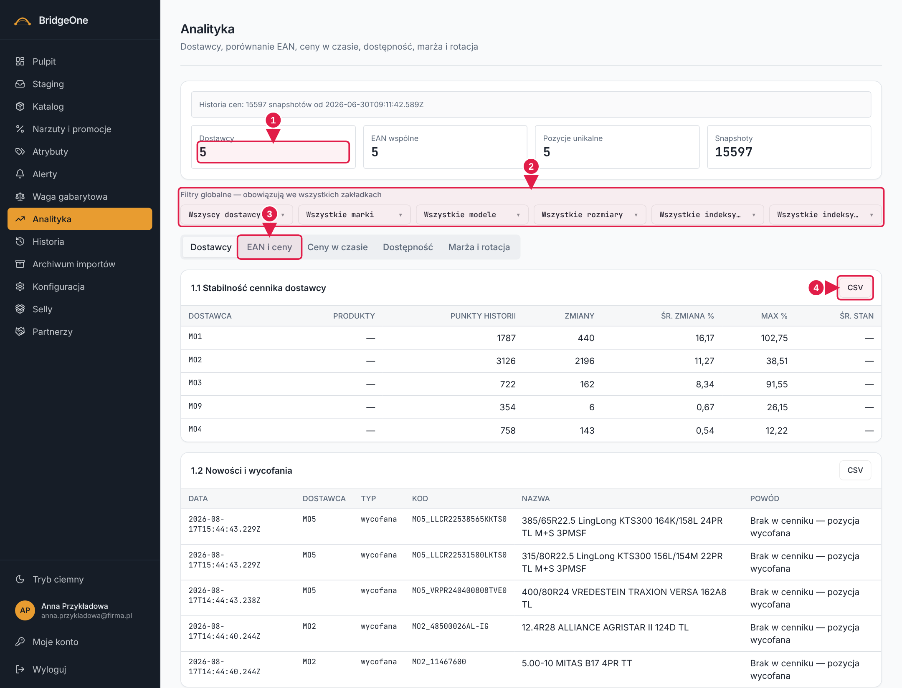

# Podręcznik Bridge — rozdział 8: Analityka

> Wersja robocza (2026-10-16). Konwencje: [rozdział 0](00-start-i-nawigacja.md).
> Ten ekran **tylko pokazuje dane** (nic tu nie edytujesz) — wszystkie ćwiczenia są bezpieczne także na produkcji.

📍 **Jak tu wejść:** menu po lewej → **Analityka** (ósma pozycja od góry, ikona wykresu). Ekran ładuje się chwilę dłużej niż
inne — to normalne, wykresy są „ciężkie".

## Do czego służy

Raporty i wykresy do analizy oferty: porównanie dostawców, ceny tych samych EAN-ów, zmiany cen w czasie,
dostępność, marża i rotacja. Każdy raport można pobrać jako CSV.

## Jak wygląda ekran (od góry do dołu)

1. **Nagłówek** „Analityka".
2. **Cztery kafle** z liczbami: **Dostawcy**, **EAN wspólne**, **Pozycje unikalne**, **Snapshoty**. Liczą całość i
   **nie reagują na filtry** (EAN wspólne i Pozycje unikalne pokazują najwyżej 1000).
3. **Filtry globalne** — rząd 6 list: **Dostawcy, Marki, Modele, Rozmiary, Indeksy nośności, Indeksy prędkości**.
   Podpis „Filtry globalne — obowiązują we wszystkich zakładkach". Po wybraniu czegokolwiek w **prawym górnym rogu
   tej sekcji** pojawia się link **Wyczyść filtry**.
4. **Zakładki:** **Dostawcy · EAN i ceny · Ceny w czasie · Dostępność · Marża i rotacja**.
5. W zakładce karty z tabelami lub wykresami; w **nagłówku każdej karty, po prawej, przycisk CSV**.

### Co jest w której zakładce
| Zakładka | Karty |
|---|---|
| **Dostawcy** | stabilność dostawców, cykl życia dostawców, stan dostawców |
| **EAN i ceny** | porównanie cen po EAN (2.1–2.4), pozycje unikalne (2.5), pokrycie wspólne i ranking dostawcy (2.6) |
| **Ceny w czasie** | zmiany cen z ostatnich importów (3.1), inflacja cennika (3.6) |
| **Dostępność** | historia dostępności pozycji (4.1), tempo schodzenia z magazynu (4.2), sezonowy wzorzec cen (4.4) |
| **Marża i rotacja** | marża per dostawca/kategoria/marka, rotacja / produkty bez aktualizacji, cykl życia modelu (4.6) |

**Analityka — ekran główny**

1. **Kafle** — liczą całość, nie reagują na filtry
2. **Filtry globalne** — działają we wszystkich zakładkach
3. **Zakładki**: Dostawcy · EAN i ceny · Ceny w czasie · Dostępność · Marża i rotacja
4. **CSV** — pobiera pełny zbiór danych tej karty

## 1. Filtry globalne

Filtry wspólne dla wszystkich zakładek: ustawiasz raz, a tabele i wykresy się zawężają. Listy rozwijane mają własną
szukajkę — wpisz fragment, żeby znaleźć pozycję, i zaznacz haczykiem (można kilka).

### ✍️ Ćwiczenia 8.1
1. Menu po lewej → **Analityka**. Poczekaj, aż wykresy się narysują.
2. Odczytaj cztery kafle u góry: zapisz liczby.
3. W rzędzie filtrów kliknij **Dostawcy** i zaznacz jednego dostawcę. Zobacz, jak zmieniają się tabele w zakładce.
4. Dodaj filtr **Marki** (wpisz fragment w szukajce listy). Kafle na górze **nie zmieniły się** — tak ma być.
5. Kliknij **Wyczyść filtry** (nad listami, po prawej).

## 2. Zakładki i karty

### ✍️ Ćwiczenia 8.2 — przejście po zakładkach
1. Kliknij kolejno wszystkie pięć zakładek. W każdej znajdź tytuły kart z tabeli powyżej.
2. W zakładce **EAN i ceny**, w karcie „2.1–2.4 Porównanie cen po EAN", odnajdź kolumny **Spread zł** i
   **Liczba dostawców** — ten sam EAN u kilku dostawców po różnych cenach.
3. W zakładce **Ceny w czasie** wpisz w karcie „3.1 Zmiany cen z ostatnich importów" kod produktu w polu EAN/Kod.
4. W zakładce **Dostępność** znajdź kartę „4.2 Tempo schodzenia z magazynu" i kolumnę **Zeszło sztuk**.
5. W zakładce **Marża i rotacja**, w karcie „Rotacja / produkty bez aktualizacji", zmień pole **Bez ruchu dni** na `60`
   — lista przeładuje się dla innego progu.

## 3. Eksport CSV

📍 **Nagłówek karty (po prawej) → przycisk „CSV".** Dwie karty go nie mają: „Sezonowy wzorzec cen" i „Cykl życia modelu".

- Plik zawiera **ten sam zestaw kolumn** co tabela i **uwzględnia filtry globalne**.
- Tabela na ekranie rysuje **najwyżej 300 wierszy**, a plik ma **wszystkie** — więc plik jest zwykle większy. To nie błąd.
- Jeśli pobranie się nie uda, dostaniesz komunikat o błędzie, a nie ucięty plik.

### ✍️ Ćwiczenia 8.3 — eksport
1. Wejdź w zakładkę **Dostępność** i kliknij **CSV** w karcie „4.1 Historia dostępności pozycji".
2. Otwórz plik w Excelu. Policz wiersze i porównaj z tabelą na ekranie.
3. Ustaw filtr globalny **Dostawcy** na jednego dostawcę i pobierz CSV jeszcze raz. Plik powinien być mniejszy.
4. Porównaj kolumny pliku z kolumnami tabeli — zgadzają się?

✅ *Umiesz, gdy:* ustawiasz filtry, przechodzisz między zakładkami i pobierasz raport w CSV z dokładnie tych danych, które chcesz.
