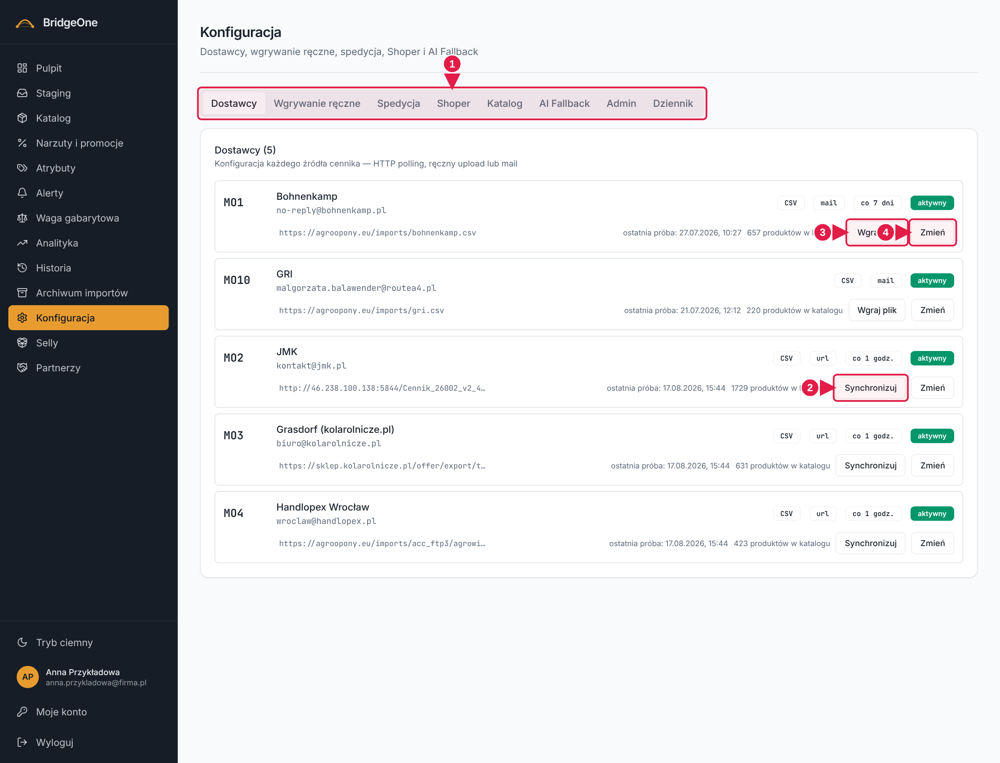
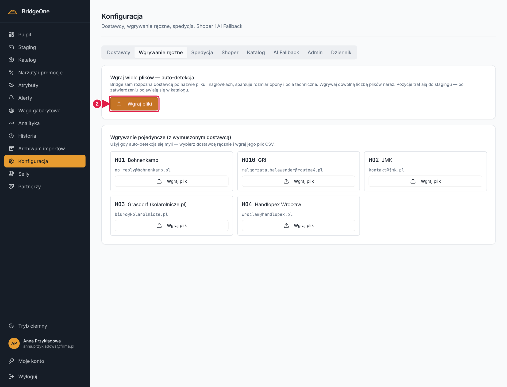
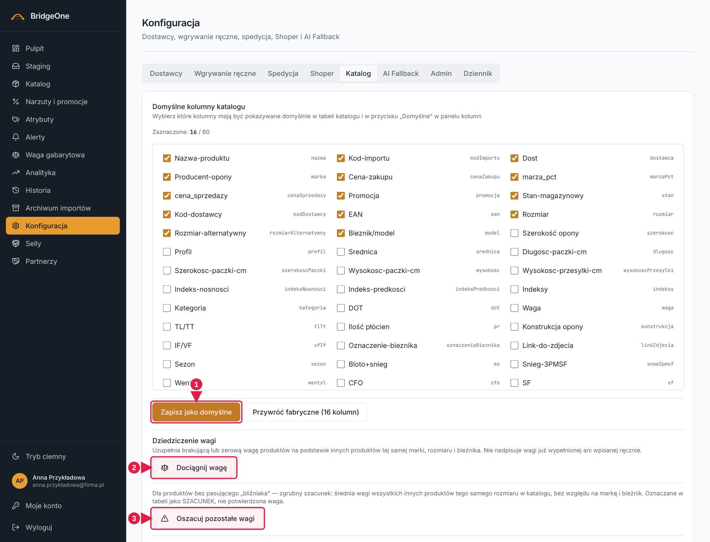

# Podręcznik Bridge — rozdział 10: Konfiguracja

> Wersja robocza (2026-10-16). Konwencje: [rozdział 0](00-start-i-nawigacja.md).
> ⚠ To **najgroźniejszy** ekran: są tu operacje na całym katalogu i na importach. Ćwiczenia z ⚠ rób wyłącznie
> na środowisku testowym (**https://training.agroopony.eu**). **Nigdy nie potwierdzaj „Usuń wszystko z katalogu" na produkcji.**

📍 **Jak tu wejść:** menu po lewej → **Konfiguracja** (jedenasta pozycja, ikona zębatki).

## Do czego służy

Ustawienia całego systemu: skąd i jak przychodzą cenniki dostawców, ręczne wgrywanie plików, limity wysyłkowe,
format eksportu do Shopera, utrzymanie katalogu i dziennik działań.

## Jak wygląda ekran

Nagłówek „Konfiguracja", pod nim **osiem zakładek** (od lewej):
**Dostawcy · Wgrywanie ręczne · Spedycja · Shoper · Katalog · AI Fallback · Admin · Dziennik**.
Wybranie zakładki podmienia treść poniżej. Ustawienia zapisują się na serwerze i przeżywają odświeżenie strony.

---

## 1. Zakładka „Dostawcy"

Karty dostawców (jedna na dostawcę). Każda pokazuje kod, nazwę, status, liczbę produktów w katalogu i czas
„ostatniej próby" pobrania. Pola konfiguracji:
- **Adres cennika (URL)**,
- **Co ile sprawdzać cennik** (lista; „Inna wartość (minuty)…" pozwala wpisać własną; puste = bez harmonogramu),
- **Sposób dostarczania** (url / upload / mail),
- przycisk **Zapisz** (dół karty).

Przyciski zależą od sposobu dostarczania:
- **Synchronizuj** (dostawca z adresem URL) — pobiera cennik od razu. Pozycje trafiają do **Stagingu**.
- **Wgraj plik** (dostawca „upload"/„mail") — wybierasz plik z dysku (CSV, XML, XLSX).
- **Zaakceptuj mniejszy cennik** — pojawia się, gdy nowy plik ma wyraźnie mniej pozycji niż poprzedni (zabezpieczenie);
  zaakceptuj, jeśli to zamierzone, i uruchom synchronizację ponownie.

**Konfiguracja — zakładka Dostawcy**

1. **Zakładki** konfiguracji (8)
2. **Synchronizuj** — pobiera cennik z adresu URL
3. **Wgraj plik** — dla dostawców „upload"/„mail"
4. **Zmień** — ustawienia dostawcy (URL, częstotliwość)

### ✍️ Ćwiczenia 10.1 ⚠ (środowisko testowe)
1. Menu po lewej → **Konfiguracja** → zakładka **Dostawcy**. Znajdź dostawcę z adresem URL.
2. Odczytaj status i „ostatnią próbę". Kliknij **Synchronizuj** i poczekaj na komunikat.
3. Przejdź do **Staging** i sprawdź, czy pojawiły się nowe pozycje.
4. Wróć do Konfiguracji → Dostawcy. Zmień częstotliwość (lista „Co ile sprawdzać cennik") na inną i kliknij **Zapisz**.
5. Odśwież stronę (F5) — ustawienie ma zostać.

## 2. Zakładka „Wgrywanie ręczne"

Dwie karty i tabela:
- **„Wgraj wiele plików — auto-detekcja"**: **Wgraj pliki**. Bridge rozpozna dostawcę po nazwie pliku i nagłówkach.
- **„Wgrywanie pojedyncze (z wymuszonym dostawcą)"**: wybierz dostawcę i **Wgraj plik** — gdy auto-detekcja się myli.
- **„Ostatni import"**: tabela z podglądem ostatnio wgranych pozycji (Kod, Nazwa, Rozmiar, Cena zakupu, Stan).

W oknie wgrywania: wybierasz pliki z dysku (albo przeciągasz je na ramkę), przy każdym widać dostawcę i pewność
rozpoznania; błędnie rozpoznane poprawiasz listą „— wybierz —". **Importuj do staging** wysyła pozycje do kolejki;
podsumowanie mówi m.in. „Do akceptacji w stagingu", „Nowe", „Zmienione", „Braki w cenniku", „Bez zmian".

**Konfiguracja — Wgrywanie ręczne**

1. **Wgraj pliki** — auto-detekcja dostawcy
2. **Wgraj plik** — wymuszony dostawca

### ✍️ Ćwiczenia 10.2 ⚠ (środowisko testowe)
1. Zakładka **Wgrywanie ręczne** → **Wgraj pliki**. Wybierz z dysku testowy cennik (lub pobierz go z **Archiwum importów**).
2. Sprawdź, czy dostawca został rozpoznany; jeśli nie, wybierz go ręcznie.
3. Kliknij **Importuj do staging**. Przeczytaj podsumowanie.
4. Wejdź w **Staging** i znajdź pozycje z tego pliku.

## 3. Zakładka „Spedycja"

Tabela „Limity spedycyjne per dostawca": **Próg netto (zł)**, **Koszt poniżej (zł)**, **Koszt powyżej (zł)**,
**Dodatkowe reguły** — po jednym wierszu na dostawcę. Zmiana pola zapisuje się (komunikat „Zapisano limity spedycyjne…").
Ustawienia są na serwerze, wspólne dla wszystkich.

## 4. Zakładka „Shoper"

Karta „Eksport CSV do Shoper": pole **Mapowanie kolumn** (jedna linia = jedna kolumna, zapis `klucz_wewnetrzny:Nagłówek_CSV`),
pole **Separator** i przyciski **Zapisz konfigurację** i **Przywróć domyślne**. Format ten jest używany przez „Pobierz CSV"
w Katalogu **tylko wtedy, gdy w Katalogu odznaczysz wszystkie kolumny**.

## 5. Zakładka „Katalog" ⚠

Karty narzędzi do utrzymania katalogu:
- **Domyślne kolumny katalogu** — zaznacz kolumny i kliknij **Zapisz jako domyślne** (lub **Przywróć fabryczne (N kolumn)**).
  To one wracają po kliknięciu „Domyślne" w przycisku „Kolumny" w Katalogu.
- **Dziedziczenie wagi** — **Dociągnij wagę**: uzupełnia brakującą wagę z innych produktów tej samej marki, rozmiaru i
  bieżnika (nie nadpisuje wpisanej ręcznie). Po operacji link „zobacz je w katalogu" pokazuje produkty, które nadal są bez wagi.
- **Oszacuj pozostałe wagi** — zgrubny szacunek ze średniej dla rozmiaru; w Katalogu oznaczony żółtym trójkątem jako SZACUNEK.
- **Uzupełnianie zdjęć** — **Pokaż propozycje zdjęć**: lista (Produkt / Proponowany link) z haczykami; **Zapisz wybrane (N)**
  zapisuje tylko zaznaczone. Link jest potem chroniony przed nadpisaniem przez import.
- **Usuń wszystko z katalogu** — *NIEODWRACALNE.* Pyta twardym okienkiem przeglądarki. **Nie używaj poza środowiskiem
  testowym i tylko z pełną świadomością.**

**Konfiguracja — zakładka Katalog**

1. **Zapisz jako domyślne** — kolumny katalogu
2. **Dociągnij wagę**
3. **Oszacuj pozostałe wagi**
4. **Pokaż propozycje zdjęć**
5. ⛔ **Usuń wszystko z katalogu** — nieodwracalne!

### ✍️ Ćwiczenia 10.3 ⚠ (środowisko testowe)
1. Zakładka **Katalog** → karta „Dziedziczenie wagi". Kliknij **Dociągnij wagę**. Przeczytaj komunikat (ile uzupełniono / pominięto).
2. Kliknij link „zobacz je w katalogu" — otworzy się Katalog z filtrem „Brak wagi".
3. Wróć do Konfiguracji → Katalog. Kliknij **Pokaż propozycje zdjęć**, odznacz kilka wierszy, kliknij **Zapisz wybrane (N)**.
4. W karcie „Domyślne kolumny katalogu" zaznacz dodatkową kolumnę i **Zapisz jako domyślne**; w Katalogu użyj
   **Kolumny → Domyślne** i sprawdź efekt.
5. **Nie klikaj** „Usuń wszystko z katalogu".

## 6. Zakładka „AI Fallback"

Gdy parser nie rozpozna kolumn cennika, może zapytać OpenAI. Pola: **Klucz API OpenAI**, **Model**, plakietka
statusu (**AKTYWNY** — klucz wpisany, **SYMULACJA** — bez prawdziwych zapytań). Klucza nie wpisujemy w testach.

## 7. Zakładka „Admin"

Trzy karty: **Dostawcy — konfiguracja importu** (tabela: Kod, Nazwa, Adres cennika, Status, Ostatni plik; edycja
zapisuje się komunikatem „Zapisano"), **Użytkownicy** (lista tylko do odczytu; hasło zmienia się w „Moje konto") oraz
**Utrzymanie katalogu** z przyciskiem **Usuń pozycje, które nie są oponami** (pyta o potwierdzenie i pokazuje, ile usunięto
i u których dostawców). ⚠ Zakładkę widzi każdy zalogowany użytkownik.

## 8. Zakładka „Dziennik"

Zapis działań (edycje, usunięcia, czyszczenia). Filtry: lista **Akcja**, lista **Encja** i szukajka „Szukaj w akcji, encji,
szczegółach…". Tabela: Data, Użytkownik, Akcja, Encja, szczegóły.

### ✍️ Ćwiczenia 10.4 — Dziennik
1. Zakładka **Dziennik**. Wybierz z listy **Akcja** jedną akcję, a potem **Encja**.
2. Wpisz w szukajce kod produktu, który edytowałaś/eś w Katalogu — znajdź swój wpis.
3. Sprawdź kolumnę **Użytkownik** — czy to Ty?

✅ *Umiesz, gdy:* wiesz, gdzie zmienić częstotliwość pobierania cennika, jak wgrać plik ręcznie i które przyciski są niebezpieczne.
