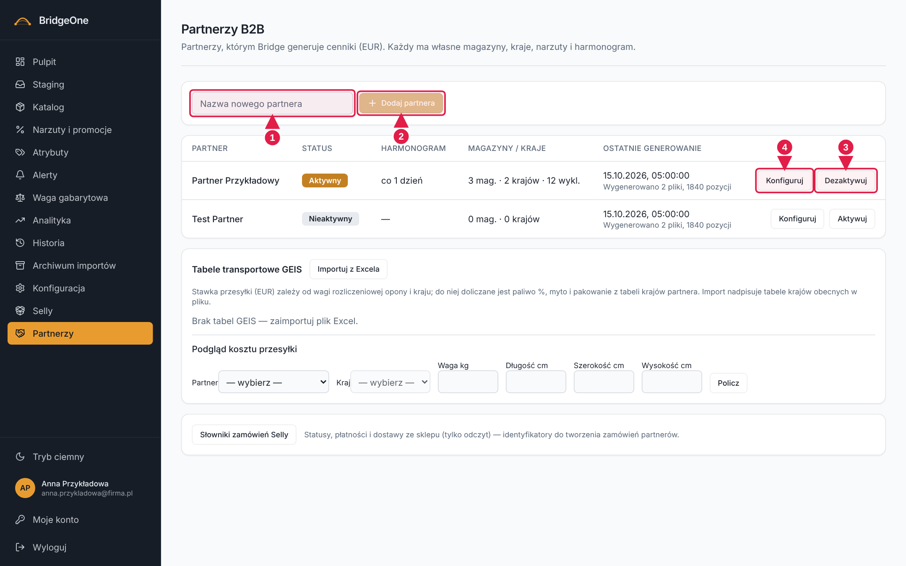
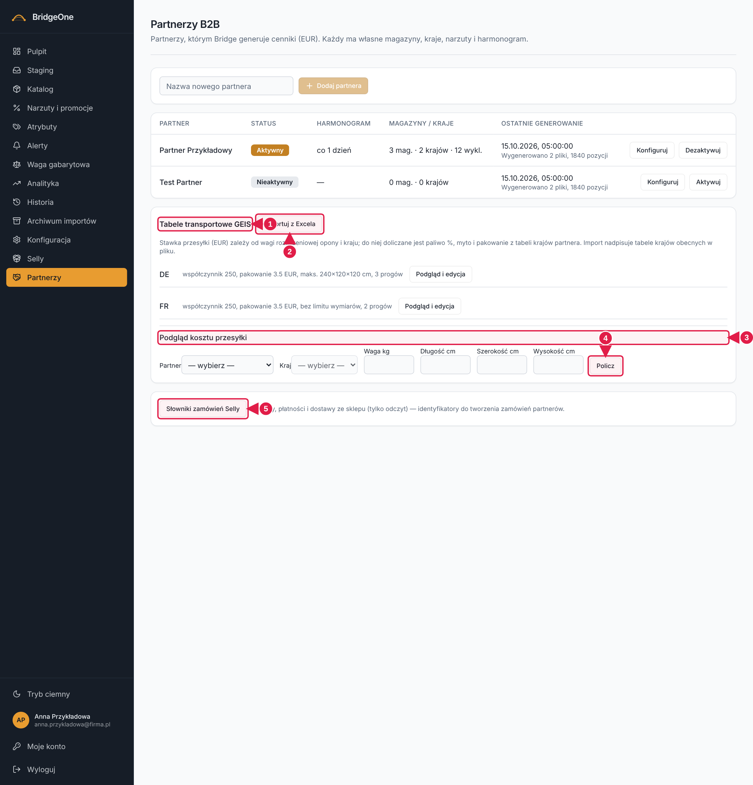
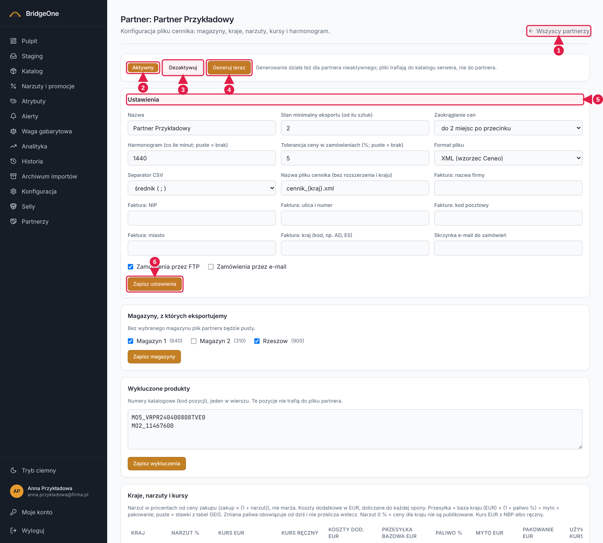
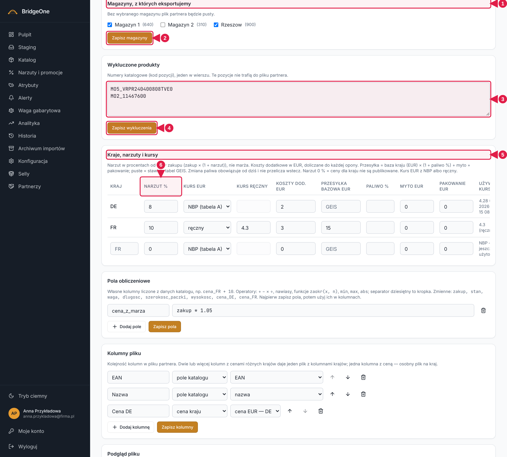
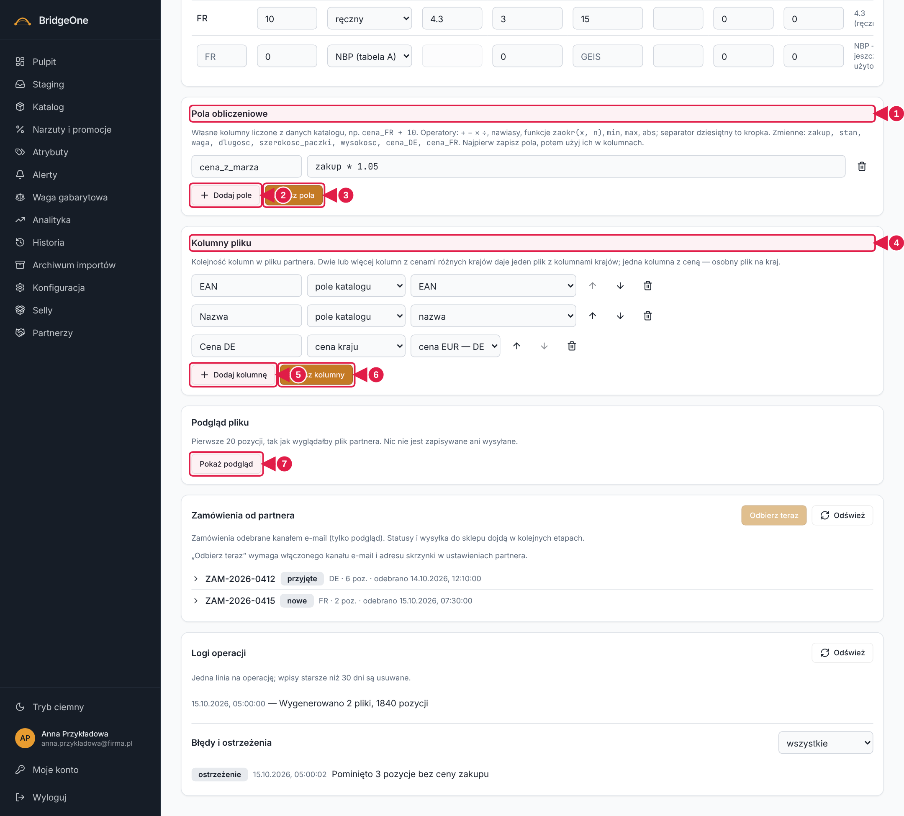
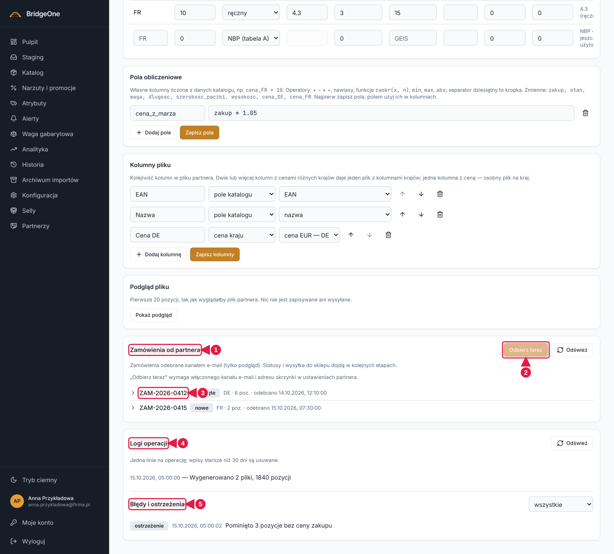

# Podręcznik Bridge — rozdział 12: Partnerzy B2B

> Wersja robocza (2026-10-16). Konwencje: [rozdział 0](00-start-i-nawigacja.md).
> ⚠ To nowy, rozbudowany moduł. Ćwiczenia z ⚠ rób na środowisku testowym (**https://training.agroopony.eu**).

📍 **Jak tu wejść:** menu po lewej → **Partnerzy** (trzynasta, ostatnia pozycja od góry, ikona uścisku dłoni).

## Do czego służy

Moduł do przygotowywania **cenników w EUR dla partnerów B2B**. Każdy partner ma własne: magazyny, wykluczone produkty,
kraje z narzutami i kursami, tabele transportowe, kolumny pliku i harmonogram generowania.

## 1. Lista partnerów

Nagłówek „Partnerzy B2B" (podtytuł: „Partnerzy, którym Bridge generuje cenniki (EUR)…"). Pod nim:
- **Pole „Nazwa nowego partnera" + przycisk Dodaj partnera** (nad tabelą) — nowy partner jest **nieaktywny**.
- **Tabela:** Partner, Status (odznaka Aktywny/Nieaktywny), Harmonogram, Ostatnie generowanie (data + opis),
  a na końcu wiersza (po prawej): **Aktywuj / Dezaktywuj** i **Konfiguruj**.

**Lista partnerów**

1. Pole **Nazwa nowego partnera**
2. **Dodaj partnera**
3. **Aktywuj / Dezaktywuj**
4. **Konfiguruj** — ekran partnera

Pod tabelą partnerów, na tej samej stronie (trzeba zjechać w dół), są trzy karty wspólne dla wszystkich partnerów:
- **Tabele transportowe GEIS** — import tabel kosztów przesyłki z pliku Excel (przycisk **Importuj z Excela**) i ich edycja per kraj;
- **Podgląd kosztu przesyłki** — wybierz partnera, kraj, wagę i wymiary paczki i kliknij **Policz**;
- **Słowniki zamówień Selly** — podgląd słowników używanych przy zamówieniach partnerów.

**Lista partnerów — dolna część strony (GEIS, podgląd kosztu, słowniki)**

1. **Tabele transportowe GEIS** — import z pliku Excel
2. **Importuj z Excela**
3. **Podgląd kosztu przesyłki** — wybierz partnera, kraj i wymiary
4. **Policz**
5. **Słowniki zamówień Selly**

### ✍️ Ćwiczenia 12.1 ⚠ (środowisko testowe)
1. Menu po lewej → **Partnerzy**. Przejrzyj kolumny tabeli.
2. W polu „Nazwa nowego partnera" wpisz `Test Partner` i kliknij **Dodaj partnera**. Nowy wiersz ma status **Nieaktywny**.
3. Kliknij **Aktywuj** w jego wierszu — odznaka zmienia się na Aktywny. Kliknij **Dezaktywuj**, żeby cofnąć.
4. Kliknij **Konfiguruj** w jego wierszu.

## 2. Ekran partnera

📍 Lista partnerów → w wierszu (po prawej) **Konfiguruj**. Link **Wszyscy partnerzy** (prawy górny róg) wraca do listy.

Nagłówek „Partner: <nazwa>", pod nim karty jedna pod drugą. Ekran jest długi — **przewijaj w dół**; każda karta ma własny przycisk zapisu
(zmiany w jednej karcie nie zapisują się razem z drugą!).

**Ekran partnera — góra: pasek aktywności i Ustawienia**

1. Link **Wszyscy partnerzy** — powrót do listy
2. Odznaka **Aktywny / Nieaktywny**
3. **Dezaktywuj** (lub Aktywuj)
4. **Generuj teraz** — tworzy pliki cennika
5. Karta **Ustawienia**: nazwa, zaokrąglanie cen, harmonogram, format pliku, kanały zamówień, dane do faktury
6. **Zapisz ustawienia**

### Pasek aktywności i Ustawienia
- **Odznaka** Aktywny / Nieaktywny, przycisk **Aktywuj / Dezaktywuj** i **Generuj teraz** (tworzy pliki cennika; działa też
  dla nieaktywnego partnera — pliki trafiają do katalogu serwera, nie do partnera). Po generowaniu widzisz „Pozycji do eksportu"
  i listę plików.
- Karta **Ustawienia**: nazwa, stan minimalny eksportu, zaokrąglanie cen, harmonogram (w minutach; puste = brak),
  tolerancja ceny, format pliku (XML wzorzec Ceneo / CSV), separator CSV, nazwa pliku, dane do faktury, kanały zamówień
  (FTP / e-mail). Zapis: **Zapisz ustawienia**.

### ✍️ Ćwiczenia 12.2 — ustawienia ⚠ (środowisko testowe)
1. Na liście partnerów kliknij **Konfiguruj** przy „Test Partner". Znajdź w prawym górnym rogu link **Wszyscy partnerzy**.
2. W pasku aktywności kliknij **Aktywuj**, a potem **Dezaktywuj**.
3. W karcie **Ustawienia** zmień **Harmonogram** na `1440` (raz na dobę) i **Zaokrąglanie cen** na inne. Kliknij **Zapisz ustawienia**.
4. Odśwież stronę (F5) — ustawienia mają zostać.

## 3. Magazyny, wykluczenia i kraje

**Ekran partnera — Magazyny, Wykluczone produkty, Kraje**

1. **Magazyny** — zaznacz te, z których eksportujemy
2. **Zapisz magazyny**
3. **Wykluczone produkty** — numery katalogowe, jeden w wierszu
4. **Zapisz wykluczenia**
5. **Kraje, narzuty i kursy** — narzut %, kurs EUR, koszty
6. Nagłówek **Narzut %**

- **Magazyny, z których eksportujemy** — haczyki przy magazynach katalogu (w nawiasie liczba pozycji). Bez wybranego
  magazynu plik partnera będzie pusty. **Zapisz magazyny**.
- **Wykluczone produkty** — numery katalogowe (kody), jeden w wierszu; te pozycje nie trafią do pliku partnera.
  **Zapisz wykluczenia**.
- **Kraje, narzuty i kursy** — jeden wiersz na kraj: **Narzut %** (liczony od ceny zakupu), **Kurs EUR** (NBP lub ręczny),
  koszty dodatkowe, przesyłka bazowa, paliwo, myto, pakowanie. Pusty wiersz na dole pozwala dodać kolejny kraj (wpisz kod, np. `DE`).
  Przycisk zapisu kraju i kosz (usuń kraj) są na końcu wiersza — **przewiń tabelę w prawo**.

### ✍️ Ćwiczenia 12.3 — magazyny i kraje ⚠ (środowisko testowe)
1. Zjedź do karty **Magazyny, z których eksportujemy**. Zaznacz jeden magazyn i kliknij **Zapisz magazyny**.
2. W karcie **Wykluczone produkty** wpisz w osobnym wierszu jeden kod produktu z Katalogu i kliknij **Zapisz wykluczenia**.
3. W karcie **Kraje, narzuty i kursy** wpisz w pustym wierszu `DE`, narzut `8` i kliknij przycisk zapisu na końcu wiersza.
4. Odśwież stronę — magazyny, wykluczenie i kraj mają zostać.

## 4. Pola obliczeniowe, kolumny pliku i podgląd

**Ekran partnera — Pola obliczeniowe, Kolumny pliku, Podgląd pliku**

1. **Pola obliczeniowe** — własne formuły
2. **+ Dodaj pole**
3. **Zapisz pola**
4. **Kolumny pliku** — kolejność i źródło danych
5. **+ Dodaj kolumnę**
6. **Zapisz kolumny**
7. **Pokaż podgląd** — pierwsze 20 pozycji, nic się nie zapisuje

- **Pola obliczeniowe** — własne kolumny liczone z danych katalogu, np. nazwa `cena_z_marza`, wzór `zakup * 1.05`.
  Dostępne zmienne: zakup, stan, waga, dlugosc, szerokosc_paczki, wysokosc oraz `cena_<kraj>`. Operatory + − × ÷, funkcje
  `zaokr(x, n)`, `min`, `max`, `abs`. Przyciski **+ Dodaj pole** i **Zapisz pola** (najpierw zapisz pola, potem używaj ich w kolumnach).
- **Kolumny pliku** — kolejność i źródło każdej kolumny: **pole katalogu**, **cena kraju** albo **pole obliczeniowe**.
  Strzałki ↑ ↓ zmieniają kolejność, kosz usuwa kolumnę. **+ Dodaj kolumnę**, **Zapisz kolumny**.
  Dwie lub więcej kolumn z cenami różnych krajów daje jeden plik z kolumnami krajów; jedna kolumna z ceną — osobny plik na kraj.
- **Podgląd pliku** — **Pokaż podgląd** pokazuje pierwsze 20 pozycji tak, jak wyglądałby plik. **Nic nie jest zapisywane ani wysyłane.**
  Poniżej widać listy **Błędy** i **Ostrzeżenia**.

### ✍️ Ćwiczenia 12.4 — kolumny i podgląd ⚠ (środowisko testowe)
1. W karcie **Pola obliczeniowe** kliknij **+ Dodaj pole**, nazwa `cena_x`, wzór `zakup * 1.1`. Kliknij **Zapisz pola**.
2. W karcie **Kolumny pliku** kliknij **+ Dodaj kolumnę**: nazwa w pliku `Cena X`, źródło **pole obliczeniowe → cena_x**. Przesuń ją strzałką ↑ na górę. **Zapisz kolumny**.
3. W karcie **Podgląd pliku** kliknij **Pokaż podgląd**. Sprawdź, czy kolumna „Cena X" jest w pliku, i przeczytaj **Ostrzeżenia**.
4. Wróć na górę ekranu i kliknij **Generuj teraz**. Odczytaj liczbę pozycji i nazwy plików.

## 5. Zamówienia, logi i błędy

**Ekran partnera — Zamówienia, Logi operacji, Błędy i ostrzeżenia**

1. **Zamówienia od partnera** — tylko odczyt
2. **Odbierz teraz** (wymaga kanału e-mail)
3. Wiersz zamówienia — klik rozwija szczegóły
4. **Logi operacji** — **Odśwież**
5. **Błędy i ostrzeżenia** — filtr poziomu

- **Zamówienia od partnera** — zamówienia odebrane kanałem e-mail (tylko podgląd). **Odbierz teraz** wymaga włączonego kanału e-mail
  i adresu skrzynki w Ustawieniach. Kliknięcie wiersza (strzałka ›) rozwija szczegóły: pozycje, adres dostawy, dane do faktury.
  Statusy: **nowe**, **przyjęte**, **błąd importu**. **Sprawdź ponownie** ponawia walidację zamówienia względem katalogu.
- **Logi operacji** — jedna linia na operację (np. „Wygenerowano 2 pliki, 1840 pozycji"); wpisy starsze niż 30 dni są usuwane. **Odśwież** wczytuje na nowo.
- **Błędy i ostrzeżenia** — lista z filtrem poziomu (wszystkie / błąd / ostrzeżenie) po prawej.

### ✍️ Ćwiczenia 12.5 — logi ⚠ (środowisko testowe)
1. Zjedź na dół ekranu partnera do karty **Logi operacji** i kliknij **Odśwież**. Znajdź wpis po swoim kliknięciu „Generuj teraz".
2. W **Błędy i ostrzeżenia** zmień filtr na „błąd". Co zostało?
3. W karcie **Zamówienia od partnera** kliknij jeden wiersz, aby go rozwinąć. Odczytaj status i liczbę pozycji.

✅ *Umiesz, gdy:* potrafisz dodać partnera, ustawić magazyny, kraje i kolumny pliku, sprawdzić podgląd, wygenerować plik i zajrzeć w logi.
